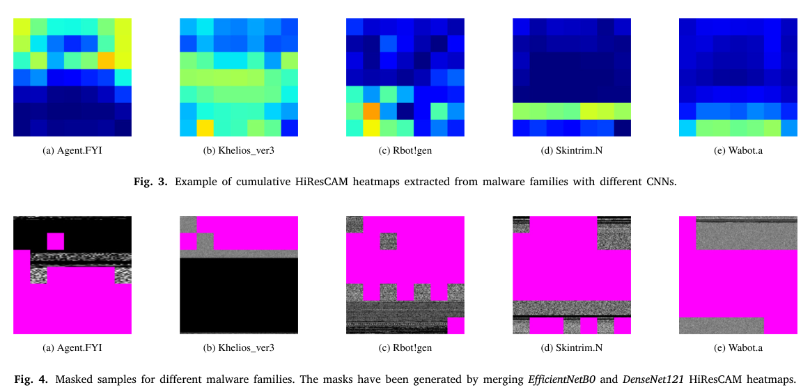
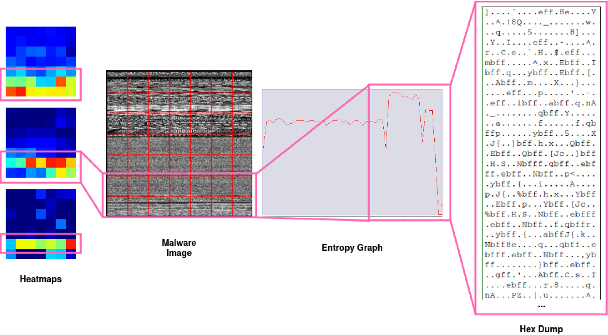

# Review Paper

## Through the Static: Demystifying Malware Visualization via Explainability

### Identitas paper

- **Penulis:** Matteo Brosolo, Vinod P., dan Mauro Conti
- **Tahun:** 2025
- **Publikasi:** *Journal of Information Security and Applications*, volume 91, artikel 104063.
- **DOI:** [10.1016/j.jisa.2025.104063](https://doi.org/10.1016/j.jisa.2025.104063)

### Tujuan penelitian

Penelitian ini mengkaji dua hal pada klasifikasi malware berbasis citra: seberapa mudah model CNN dari penelitian terdahulu direplikasi, dan bagaimana menjelaskan area citra yang memengaruhi prediksi. Penulis membandingkan GradCAM dengan HiResCAM, merangkum heatmap per keluarga malware, lalu memakai heatmap tersebut untuk membuat masker citra dan menguji pengaruhnya pada klasifikasi dengan Vision Transformer (ViT).

### Dataset dan evaluasi

Eksperimen menggunakan tiga dataset citra malware:

- **MalImg:** 9.339 citra grayscale, 25 kelas.
- **Microsoft BIG-2015 (BIG2015/MMCC):** 10.860 executable, 9 keluarga.
- **VX-Zoo:** dataset baru yang dibuat penulis, berisi 15.659 sampel dari 15 keluarga malware yang dikumpulkan untuk tahun 2015–2022. Distribusi kelas dan proporsi sampel packed tidak seimbang.

Enam CNN yang direplikasi adalah Gibert CNN, VGG16, ResNet50, IMCFN, DenseNet121, dan EfficientNetB0. Pada tabel performa CNN utama, penulis menggunakan pembagian 70/30 dan menyisihkan 10% dari bagian training untuk validasi. Metrik meliputi accuracy, precision, recall, F1-score, confusion matrix, serta SSIM antara heatmap kumulatif. Eksperimen menggunakan Keras dengan TensorFlow 2.9.1, Python 3.7, dan Colab Pro+ dengan GPU T4 untuk training; komputer lokal Windows 11 dengan RAM 16 GB dan Intel Core i7 dipakai untuk preprocessing dan scripting.

*Gambar 1. Fig. 3 memperlihatkan heatmap kumulatif HiResCAM; Fig. 4 memperlihatkan contoh citra setelah masking. Gambar asli dari Brosolo et al. (2025).* 

### Metode atau arsitektur model

Pertama, penulis mereplikasi enam arsitektur CNN dan membuat heatmap kelas menggunakan **GradCAM** dan **HiResCAM**. Heatmap sampel dalam kelas dirata-ratakan menjadi heatmap kumulatif untuk membandingkan area yang digunakan CNN dalam mengenali keluarga malware. Penulis juga menghitung SSIM antar-heatmap sebagai ukuran kemiripan interpretasi model.

Untuk eksperimen masking, heatmap dari dua CNN digabungkan dengan operasi OR. Piksel dengan nilai heatmap di bawah ambang 0,3 ditutupi, sedangkan area yang dianggap penting dibiarkan terlihat. Citra termasker kemudian digunakan untuk melatih ViT. Pasangan heatmap yang diuji mencakup EfficientNetB0 + DenseNet121 (ED) dan EfficientNetB0 + ResNet50 (RE). Tanda “a” pada tabel hasil menunjukkan penggunaan GradCAM; hasil tanpa tanda tersebut menggunakan HiResCAM.

*Gambar 2. Contoh alur analisis heatmap hingga pemeriksaan entropy dan hex dump pada sampel Elkern. Gambar asli dari Brosolo et al. (2025), Fig. 9.*

### Domain penelitian

**Cybersecurity, computer vision, dan explainable AI**, khususnya interpretabilitas serta replikasi model klasifikasi malware berbasis citra.

### Hasil utama

Pada pengujian ViT, hasil F1-score yang tercantum pada Tabel 9 adalah:

| Dataset | ViT tanpa masking (F1) | Hasil terbaik dengan HiResCAM (F1) | Selisih F1 | Kombinasi masker |
|---|---:|---:|---:|---|
| BIG2015 | 80,3% | 89,2% | +8,9 poin persentase | ED |
| MalImg | 92,9% | 95,3% | +2,4 poin persentase | ED |
| VX-Zoo | 87,1% | 89,2% | +2,1 poin persentase | RE |

Untuk accuracy, nilai ViT dasar dan hasil terbaik HiResCAM yang tercantum masing-masing adalah 90,7% menjadi 95,4% pada BIG2015, 97,2% menjadi 98,2% pada MalImg, dan 92,7% menjadi 93,3% pada VX-Zoo. Hasil ini menunjukkan peningkatan pada konfigurasi terbaik yang ditampilkan, tetapi tidak semua kombinasi masker meningkatkan seluruh metrik; misalnya MalImg dengan GradCAM-ED memiliki F1 92,3%, di bawah baseline 92,9%.

Pada eksperimen replikasi CNN, model terbaik berbeda menurut dataset: DenseNet121 memperoleh F1 96,5% pada BIG2015, EfficientNetB0 F1 97,3% pada MalImg, dan EfficientNetB0 F1 95,5% pada VX-Zoo. Penulis juga melaporkan adanya selisih antara hasil replikasi dengan hasil awal paper-paper CNN yang direplikasi, dengan perubahan F1 dari −0,029 sampai +0,004 pada perbandingan tersebut.

### Analisis kontribusi model

Paper menghubungkan interpretabilitas CNN dengan kinerja classifier lain: heatmap dari CNN dipakai untuk mempertahankan area yang dinilai penting dan menutupi area lain sebelum ViT dilatih. Hasil Tabel 9 menunjukkan bahwa kombinasi masking HiResCAM tertentu meningkatkan F1 ViT pada ketiga dataset dibanding baseline ViT tanpa masking. Ini merupakan eksperimen ViT pada klasifikasi citra malware, tetapi ViT berperan sebagai penguji teknik masking, bukan sebagai perbandingan arsitektur ViT dengan Mamba. Nilai SSIM yang diusulkan adalah ukuran kemiripan antar-heatmap; nilainya tidak sama dengan pengukuran ketahanan terhadap serangan atau perubahan data.

### Kelebihan

1. Memeriksa ulang enam CNN dan menunjukkan bahwa hasil yang dipublikasikan tidak selalu dapat direproduksi secara persis hanya dari rincian paper.
2. Menggunakan dua teknik interpretabilitas, GradCAM dan HiResCAM, serta membandingkan pola heatmap antar-model dan antar-kelas.
3. Menyertakan VX-Zoo dengan variasi tahun, kelas, dan proporsi packed yang dijelaskan dalam paper.
4. Menguji apakah interpretasi CNN dapat dimanfaatkan untuk meningkatkan klasifikasi ViT melalui masking.
5. Menyediakan analisis kualitatif yang menghubungkan area heatmap dengan bagian binary, entropy, dan contoh string/hex pada sampel tertentu.

### Keterbatasan

1. Dataset yang dipakai adalah MalImg, BIG2015, dan VX-Zoo; paper tidak mengevaluasi MaleVis RGB.
2. ViT yang diuji menggunakan implementasi Keras minimalis; penulis sendiri menyebut perlunya implementasi ViT yang lebih kompetitif. Paper tidak membandingkan ViT dengan Vision Mamba.
3. Detail implementasi dan pembagian data dari studi CNN terdahulu tidak selalu tersedia atau konsisten, sehingga sebagian hyperparameter harus dituning atau disimpulkan oleh penulis.
4. Penulis menyatakan tidak melakukan ablation study untuk komponen model yang direplikasi karena struktur model yang ringkas.
5. Penggunaan SSIM sebagai indikator perbedaan area fokus heatmap tidak dengan sendirinya membuktikan robustness classifier terhadap obfuscation atau serangan.
6. Klaim bahwa semua kombinasi masker mengungguli baseline tidak sepenuhnya cocok dengan Tabel 9: MalImg GradCAM-ED menghasilkan F1 92,3%, di bawah baseline 92,9%.
7. VX-Zoo berisi keluarga malware dan rentang tahun tertentu; penulis menyatakan pengujian tambahan pada dataset lebih beragam dan lebih banyak kelas masih diperlukan.

### Kesimpulan review

Paper ini menggabungkan studi replikasi CNN, analisis explainability melalui GradCAM/HiResCAM dan SSIM, serta eksperimen masking heatmap untuk ViT. Pada konfigurasi HiResCAM terbaik yang dilaporkan, F1 ViT meningkat 8,9 poin persentase pada BIG2015, 2,4 pada MalImg, dan 2,1 pada VX-Zoo. Hasilnya relevan untuk kajian ViT dan explainability pada klasifikasi malware berbasis citra, tetapi bukan evaluasi MaleVis RGB atau perbandingan langsung ViT–Vision Mamba. Interpretasi peningkatan juga perlu memperhatikan variasi hasil antar-masker dan keterbatasan replikasi.

### Sumber

1. Brosolo, M., Vinod, P., & Conti, M. (2025). *Through the static: Demystifying malware visualization via explainability*. **Journal of Information Security and Applications, 91**, 104063. [ScienceDirect](https://www.sciencedirect.com/science/article/pii/S2214212625001000) · [DOI](https://doi.org/10.1016/j.jisa.2025.104063).
2. [PDF artikel di ScienceDirect](https://www.sciencedirect.com/science/article/pii/S2214212625001000/pdfft?isDTMRedir=true&download=true).
3. [Kode dan data replikasi di GitLab](https://gitlab.com/mBRS_/reproducibility_explainability).
