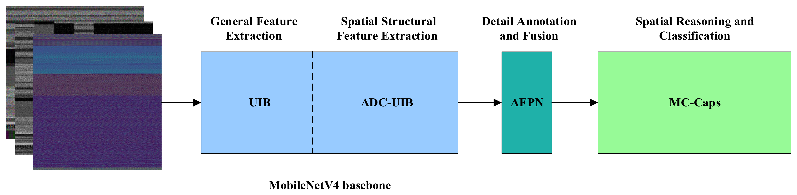
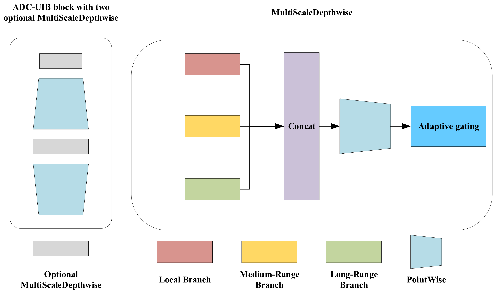
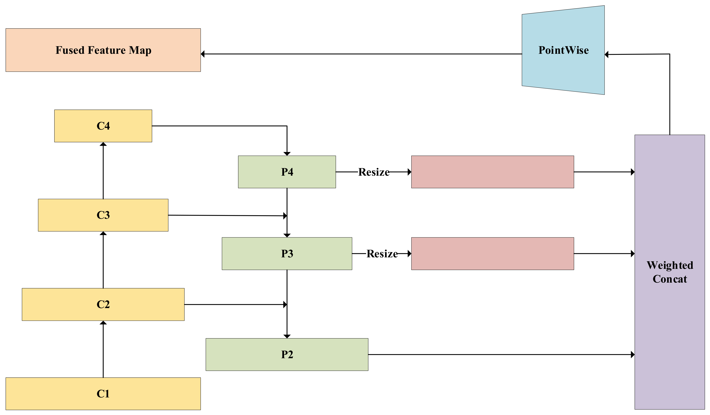
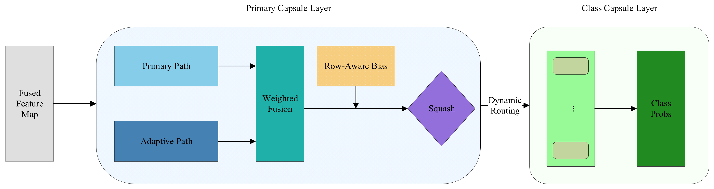
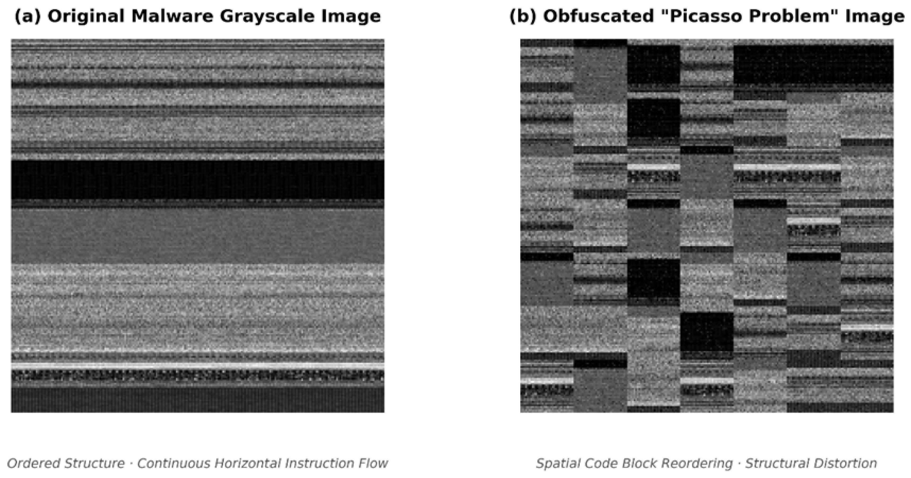
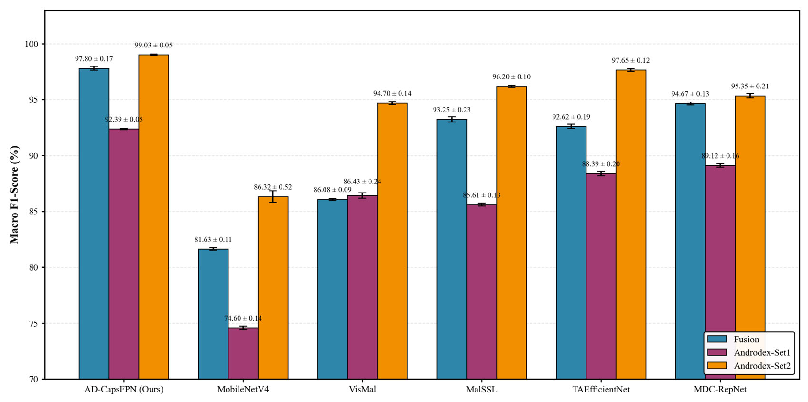

# Review Paper

## AD-CapsFPN: An Asymmetric Dilated Convolutional Capsule Network with Feature Pyramid for Malware Classification

### Penulis & Tahun

Longcheng Wang, Jin Li, Yafei Song, Yanbing Ren, dan Yunfei Xu (**2026**).

### Judul Penelitian

*AD-CapsFPN: An Asymmetric Dilated Convolutional Capsule Network with Feature Pyramid for Malware Classification*

### Nama Jurnal / Conference

Artikel jurnal pada **Electronics**, Volume 15, Article 2355, tahun 2026. DOI: `10.3390/electronics15112355`.

### Dataset

Penelitian mengevaluasi model pada dua sumber data utama:

1. **Fusion dataset**, gabungan tiga dataset malware dengan 59 keluarga malware, sumber sampel yang heterogen, dan distribusi kelas yang tidak seimbang.
2. **Androdex dataset**, yang digunakan untuk menguji ketahanan model terhadap malware yang telah mengalami obfuscation, yaitu:
   - **Androdex-Set1**, berbasis AVPass;
   - **Androdex-Set2**, berbasis Obfuscapk.

Fusion digunakan untuk menguji generalisasi pada data heterogen dan long-tailed, sedangkan Androdex digunakan untuk menguji robustness terhadap perubahan struktur citra malware.

### Metode / Model

Paper ini termasuk **computer vision untuk klasifikasi malware berbasis citra**. Model AD-CapsFPN menggunakan tiga tahap utama: **Rectification - Fusion - Inference**.

#### 1. ADC-UIB

**Asymmetric Dilated Convolutional UIB** dibangun di atas MobileNetV4. Modul ini mempertahankan sampling rapat pada arah horizontal untuk menjaga kontinuitas instruction stream, tetapi memperluas receptive field secara vertikal.

Konfigurasi dilation utama adalah `(2, 5, 9)` pada arah vertikal dan `(1, 1, 1)` pada arah horizontal. Receptive field vertikal dapat mencapai 19, sedangkan receptive field horizontal tetap 3.

#### 2. AFPN

**Adaptive Feature Pyramid Network** menggabungkan fitur multi-skala dari beberapa tahap MobileNetV4. Bobot setiap skala dipelajari secara adaptif sehingga model dapat memilih fitur yang paling relevan untuk setiap sampel malware.

#### 3. MC-Caps

**Malware-Aware Capsule Network** menggantikan global average pooling dan classification head biasa. Tujuannya adalah mempertahankan informasi posisi serta memodelkan hubungan part-whole pada fitur malware yang tersebar.

### Konsep Utama: Malware Picasso Problem

Penulis menyebut perubahan posisi blok kode akibat polymorphic obfuscation sebagai **Malware Picasso Problem**. Citra malware dapat mengalami perubahan susunan spasial, walaupun fungsi berbahaya program tetap sama. CNN biasa cenderung hanya mengenali keberadaan fitur, tetapi kehilangan hubungan antarbagian ketika menggunakan global pooling.

### Hasil Utama

Hasil Macro F1-score model lengkap AD-CapsFPN adalah:

| Dataset | Macro F1-score |
| --- | ---: |
| Fusion | **97,98%** |
| Androdex-Set1 | **92,45%** |
| Androdex-Set2 | **99,09%** |

Pada Fusion, AD-CapsFPN mengungguli MobileNetV4 baseline sebesar 16,22 poin persentase, dari 81,76% menjadi 97,98%. Pada Androdex-Set1, model mengungguli MDC-RepNet 88,97% dan TAEfficientNet 88,15%.

### Ablation Study

| Konfigurasi | Fusion | Androdex-Set1 | Androdex-Set2 |
| --- | ---: | ---: | ---: |
| MobileNetV4 baseline | 81,76% | 74,62% | 86,36% |
| ADC-UIB saja | 88,43% | 87,55% | 94,59% |
| AFPN saja | 91,29% | 87,22% | 95,53% |
| MC-Caps saja | 89,68% | 88,81% | 95,14% |
| AD-CapsFPN lengkap | **97,98%** | **92,45%** | **99,09%** |

MC-Caps merupakan komponen paling menentukan. Ketika MC-Caps dihilangkan dari model lengkap, performa turun menjadi 92,12% pada Fusion, 88,39% pada Androdex-Set1, dan 95,96% pada Androdex-Set2.

### Kompleksitas Model

| Model | Parameter | FLOPs | Inference |
| --- | ---: | ---: | ---: |
| GAP+FC | 28,93 M | 22,54 G | 20,31 ms/citra |
| AD-CapsFPN | 43,21 M | 25,56 G | 19,67 ms/citra |
| AD-CapsFPN-3R | 43,21 M | 25,56 G | 24,62 ms/citra |

AD-CapsFPN menambah jumlah parameter dan biaya training karena capsule routing, tetapi inference satu iterasi tetap efisien. Model memiliki overhead FLOPs sekitar 13,4% dibandingkan baseline GAP+FC.

### Kelebihan

- Memasukkan prior struktural malware ke dalam desain arsitektur.
- Mempertahankan kontinuitas instruction stream pada arah horizontal.
- Menggabungkan fitur lokal, multi-skala, dan hubungan spasial.
- Lebih robust terhadap obfuscation yang mengubah tata letak blok kode.
- Evaluasi mencakup dataset heterogen, distribusi long-tailed, dan malware ter-obfuscation.

### Keterbatasan

- Capsule routing meningkatkan jumlah parameter dan waktu training.
- Evaluasi terhadap malware family yang benar-benar baru dan strategi obfuscation yang terus berkembang masih perlu diperluas.
- Validasi praktis pada lingkungan deployment dengan sumber daya terbatas belum sepenuhnya dilakukan.
- Generalisasi pada dataset malware lain seperti BIG 2015 dan Malimg masih menjadi pekerjaan lanjutan.

### Kesimpulan Review

AD-CapsFPN merupakan pendekatan yang kuat untuk klasifikasi malware berbasis citra. Kontribusi utamanya adalah penggunaan convolution asimetris, feature pyramid adaptif, dan capsule network yang malware-aware. Hasil eksperimen menunjukkan peningkatan besar pada data heterogen dan citra malware yang mengalami obfuscation. Trade-off utamanya adalah kompleksitas model yang lebih tinggi, tetapi peningkatan robustness dan Macro F1-score membuat metode ini relevan untuk penelitian computer vision, CNN, dan malware image classification.

### Sumber

1. Wang, L., Li, J., Song, Y., Ren, Y., & Xu, Y. (2026). *AD-CapsFPN: An Asymmetric Dilated Convolutional Capsule Network with Feature Pyramid for Malware Classification*. **Electronics, 15**, 2355. https://doi.org/10.3390/electronics15112355
2. [Halaman sumber artikel di MDPI](https://www.mdpi.com/2079-9292/15/11/2355)
