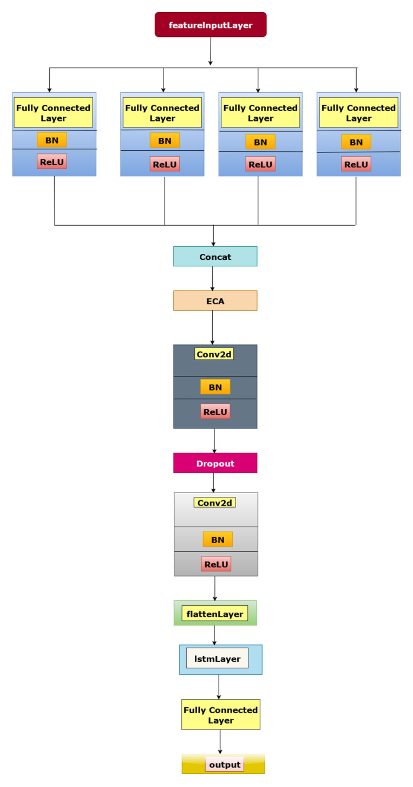
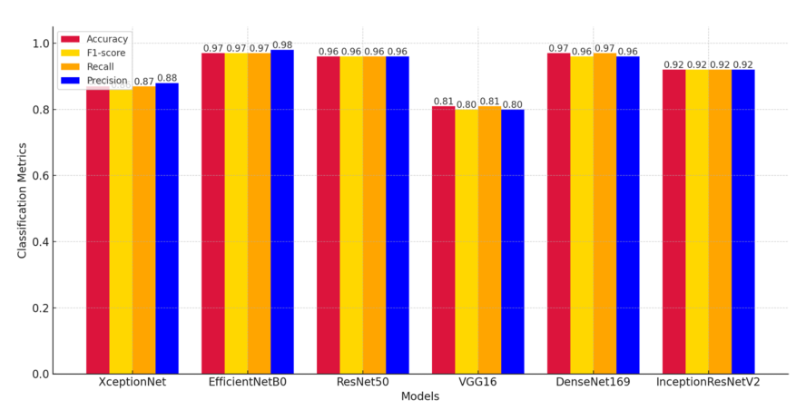
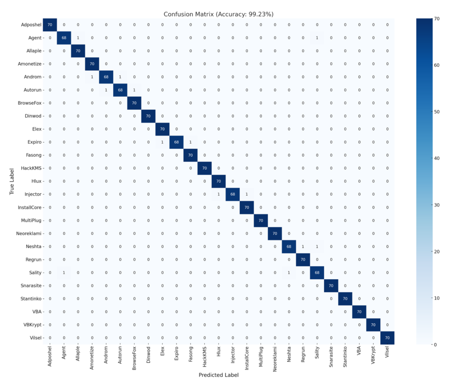
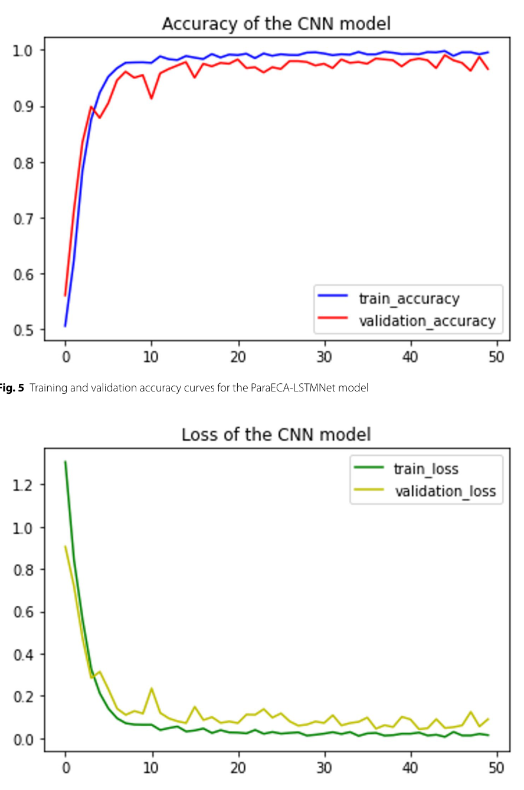

# Review Paper

## Cybersecurity Oriented Malware Classification Using ParaECA-LSTMNet with a Hybrid Attention Guided CNN-LSTM Framework

### Identitas paper

- **Penulis:** Roise Uddin, Mohammad Mahmudur Rahman, Hossain Ahmed, Amir Hossain Fahad, Aktarun Nesa, Mazharul Islam Arman, dan Chala Wata.
- **Tahun:** 2026. Metadata artikel menyebut *Discover Analytics*, volume 4, artikel 2.
- **Publikasi:** *Discover Analytics*, 4, 2.
- **DOI:** [10.1007/s44257-025-00053-2](https://doi.org/10.1007/s44257-025-00053-2).
- **Sumber:** [Halaman Springer](https://link.springer.com/article/10.1007/s44257-025-00053-2) · [PDF artikel](https://link.springer.com/content/pdf/10.1007/s44257-025-00053-2.pdf).

### Tujuan penelitian

Paper mengusulkan ParaECA-LSTMNet untuk klasifikasi keluarga malware dari citra grayscale hasil konversi biner. Model dirancang menggabungkan ekstraksi fitur paralel, perhatian kanal ECA, dan pemodelan sekuens LSTM. Penulis membandingkannya dengan beberapa arsitektur CNN pada dataset Malimg.

### Dataset dan evaluasi

Eksperimen menggunakan Malimg, yang disebut berisi 9.339 citra grayscale dari 25 keluarga malware. Data dibagi stratified menjadi 70% training, 15% validation, dan 15% test; bagian metodologi menyebut tiap kelas memiliki 70 sampel pada test set, total 1.750. Metrik yang dilaporkan mencakup accuracy, precision, recall, F1-score, confusion matrix, serta metrik per kelas.

Penulis melaporkan ParaECA-LSTMNet memperoleh accuracy 99,23%, precision 99,23%, recall 99,20%, dan F1 99,20% pada ringkasan utama. Angka ringkasan tabel dan narasi lain tidak sepenuhnya konsisten, sehingga perlu membaca nilai dengan merujuk ke tabel masing-masing. Hasil tersebut berasal dari Malimg grayscale, bukan MaleVis RGB.

*Gambar 1. Diagram arsitektur model ParaECA-LSTMNet; Fig. 2 pada paper.*

*Gambar 2. Grafik metrik enam baseline CNN; Fig. 3 pada paper. Grafik ini tidak menampilkan ParaECA-LSTMNet, yang dilaporkan terpisah dalam tabel.*

*Gambar 3. Confusion matrix ParaECA-LSTMNet pada test set Malimg; Fig. 4 pada paper.*

*Gambar 4. Kurva training/validation accuracy dan loss; Fig. 5 dan Fig. 6 pada paper.*

### Metode atau arsitektur model

Input adalah citra grayscale 224×224 yang dinormalisasi. Arsitektur mengirim fitur ke empat cabang paralel, menggabungkannya, lalu menerapkan Efficient Channel Attention (ECA), dua blok convolutional, flatten, dan LSTM unidirectional 128 unit sebelum dense-softmax untuk 25 kelas. Paper menyebut sekitar 3,9 juta parameter. Baseline mencakup XceptionNet, EfficientNetB0, ResNet50, VGG16, DenseNet169, dan InceptionResNetV2.

### Domain penelitian

Computer vision untuk keamanan siber: klasifikasi keluarga malware berbasis citra grayscale dari berkas biner. Dataset yang digunakan adalah Malimg.

### Hasil utama

- Model usulan mencapai hasil ringkasan 99,23% accuracy, 99,23% precision, 99,20% recall, dan 99,20% F1.
- Tabel perbandingan menyebut EfficientNet-B0 97,43% accuracy; beberapa bagian narasi membulatkan baseline EfficientNet/DenseNet menjadi sekitar 97%.
- Tabel per kelas melaporkan skor tinggi pada sebagian besar dari 25 kelas, tetapi kelas Neshta dan Sality memiliki nilai F1 sekitar 0,96.
- Penulis menyatakan model berpotensi menjadi pre-filter statis, tetapi paper belum menunjukkan evaluasi lintas dataset atau validasi dalam deployment operasional.

### Analisis kontribusi model

Kontribusi utamanya adalah kombinasi cabang paralel, ECA, CNN, dan LSTM untuk memanfaatkan fitur spasial multi-skala dan dependensi pada representasi citra. Relevansinya terhadap tesis cukup dekat pada klasifikasi malware berbasis citra dan dataset Malimg; hasilnya dapat menjadi pembanding konseptual CNN-hybrid. Namun, paper menggunakan grayscale Malimg, bukan citra RGB MaleVis, dan tidak membandingkan Vision Transformer maupun Vision Mamba.

### Kelebihan

1. Menguji model usulan terhadap beberapa backbone CNN dan menyertakan metrik per kelas serta confusion matrix.
2. Menyebut pembagian data stratified dan melaporkan konfigurasi perangkat lunak serta perangkat keras.
3. Menggabungkan perhatian kanal dan LSTM dalam pipeline citra malware, dengan jumlah parameter yang dilaporkan sekitar 3,9 juta.
4. Membahas keterbatasan seperti dataset tunggal, potensi drift keluarga malware, dan perlunya uji robustness lanjutan.

### Keterbatasan

1. Eksperimen hanya menggunakan dataset Malimg; performa pada dataset dan distribusi malware lain belum diuji.
2. Terdapat inkonsistensi dalam pelaporan eksperimen: metodologi menyebut pelatihan 100 epoch, sedangkan keterangan kurva menyebut 50 epoch. Sejumlah nilai baseline juga berbeda antara narasi dan tabel.
3. Uji robustness terhadap obfuscation dan serangan adversarial belum dilaporkan; paper menyebut evaluasi tersebut sebagai pekerjaan mendatang.
4. Perbandingan model terbatas pada beberapa arsitektur deep learning, sehingga belum menunjukkan performa relatif pada cakupan model yang lebih luas.

### Kesimpulan review

Paper ini mengusulkan arsitektur hybrid ParaECA-LSTMNet untuk klasifikasi citra malware grayscale dan melaporkan hasil eksperimen pada dataset Malimg. Kombinasi cabang paralel, perhatian kanal ECA, dan LSTM menunjukkan potensi untuk tugas tersebut. Namun, cakupan evaluasi dan inkonsistensi pelaporan hasil perlu dipertimbangkan saat menafsirkan performanya.

### Sumber

Uddin, R., Rahman, M. M., Ahmed, H., Fahad, A. H., Nesa, A., Arman, M. I., & Wata, C. (2026). *Cybersecurity oriented malware classification using ParaECA-LSTMNet with a hybrid attention guided CNN-LSTM framework*. **Discover Analytics, 4**, 2. [Springer](https://link.springer.com/article/10.1007/s44257-025-00053-2) · [PDF](https://link.springer.com/content/pdf/10.1007/s44257-025-00053-2.pdf) · [DOI](https://doi.org/10.1007/s44257-025-00053-2).
