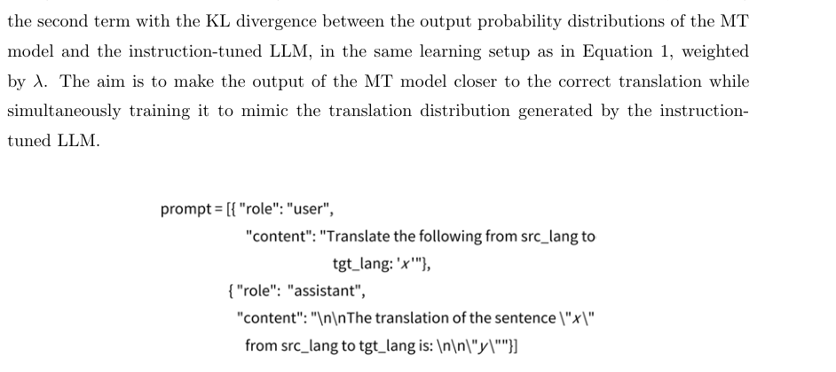
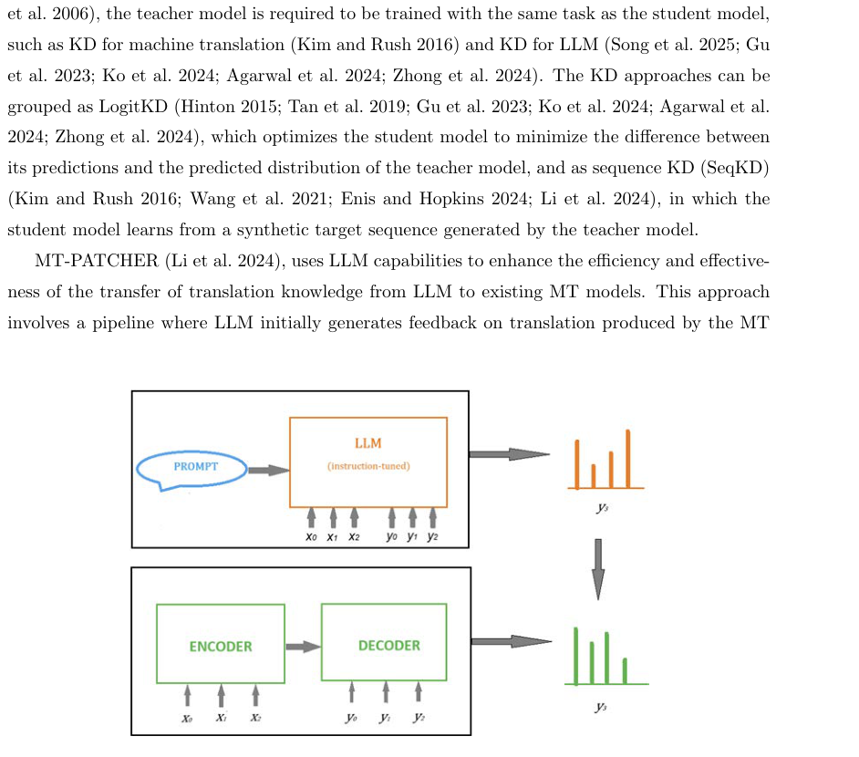
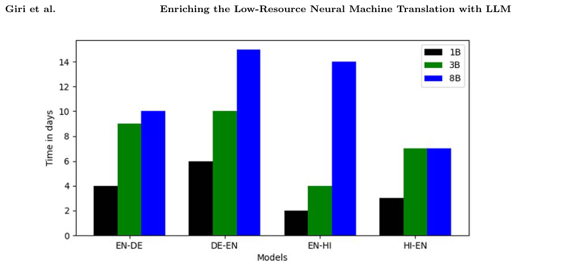
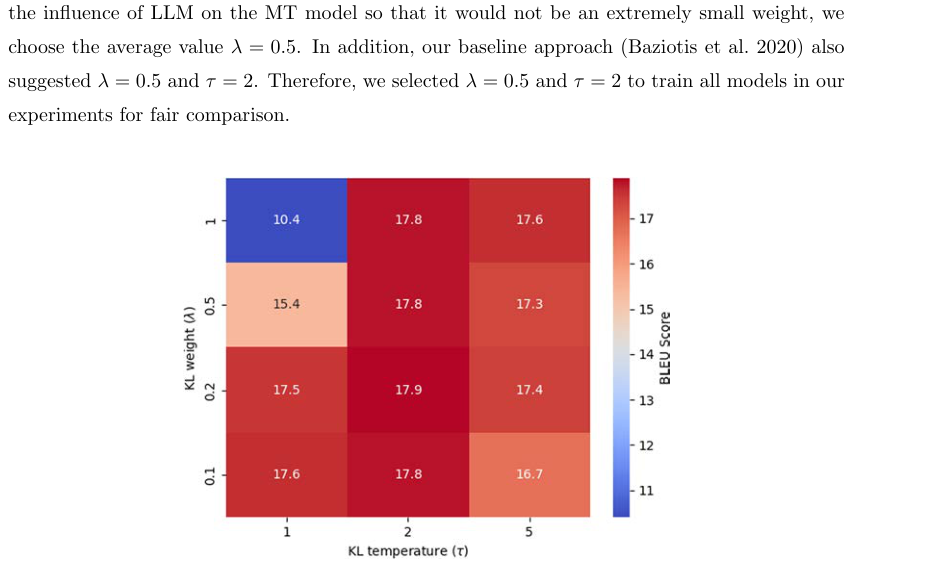

# Review Paper

## Enriching the Low-Resource Neural Machine Translation with Large Language Model

### Penulis & Tahun

Sachin Giri, Takashi Ninomiya, dan Isao Goto (**2026**).

### Judul Penelitian

*Enriching the Low-Resource Neural Machine Translation with Large Language Model*

### Nama Jurnal

Artikel penelitian **peer-reviewed** pada **Journal of Natural Language Processing**, Volume 33, Issue 3, halaman 1460-1483, tahun 2026. Artikel tersedia secara open access.

DOI: `10.5715/jnlp.33.1460`.

### Tujuan Penelitian

Penelitian ini mengatasi keterbatasan parallel corpus pada neural machine translation (NMT) untuk bahasa sumber daya rendah. Penulis memanfaatkan kemampuan Large Language Model (LLM) untuk membantu model NMT yang lebih kecil.

### Dataset dan Skenario Eksperimen

Eksperimen dilakukan pada empat arah penerjemahan:

- English-German;
- German-English;
- English-Hindi;
- Hindi-English.

Jumlah data parallel dibatasi untuk mensimulasikan kondisi low-resource. Evaluasi menggunakan **BLEU** dan **COMET**.

### Metode / Model

Metode yang diusulkan menggunakan LLM sebagai **teacher** dan NMT sebagai **student**. Pengetahuan dari LLM dimasukkan ke model penerjemahan sebagai prior distribution melalui knowledge distillation.

Alur utama metode adalah:

1. LLM menerima prompt penerjemahan dan menghasilkan distribusi probabilitas token target.
2. Model NMT menghasilkan distribusi probabilitasnya sendiri.
3. Distribusi LLM dan NMT dibandingkan menggunakan objective knowledge distillation.
4. NMT belajar memanfaatkan pengetahuan bahasa target dari LLM.
5. Setelah training selesai, inference dilakukan hanya menggunakan model NMT sehingga tidak membutuhkan LLM.

### Tugas NLP

Paper ini berfokus pada **Neural Machine Translation**, yaitu menerjemahkan teks dari satu bahasa ke bahasa lain menggunakan model neural. Fokus khususnya adalah penerjemahan pada kondisi data parallel yang terbatas.

### Hasil Utama

Penggunaan LLM sebagai teacher menghasilkan peningkatan skor BLEU dan COMET pada beberapa kondisi low-resource dibandingkan model NMT tanpa pengetahuan LLM.

Penelitian juga menganalisis pengaruh hyperparameter knowledge distillation terhadap BLEU score pada arah English-German.

### Analisis Kontribusi Model

Kontribusi utama metode ini adalah:

- memanfaatkan kemampuan translasi LLM tanpa menggunakan LLM saat inference;
- mentransfer pengetahuan LLM ke model NMT melalui distillation;
- mengurangi ketergantungan pada parallel corpus berukuran besar;
- memungkinkan model student yang lebih kecil digunakan pada deployment.

### Kelebihan

- Merupakan metode NLP baru, bukan paper survey.
- Fokus pada masalah nyata dalam machine translation low-resource.
- Menguji lebih dari satu pasangan bahasa.
- Menghasilkan model NMT yang dapat digunakan tanpa akses LLM saat inference.
- Menggunakan BLEU dan COMET sebagai metrik evaluasi.

### Keterbatasan

- Eksperimen hanya mencakup bahasa Inggris, Jerman, dan Hindi.
- Proses training tetap memerlukan akses dan biaya komputasi LLM.
- Generalisasi ke bahasa dengan script atau struktur yang sangat berbeda masih perlu diuji.
- Kinerja model bergantung pada kualitas LLM teacher dan desain prompt.

### Kesimpulan Review

Metode ini menggunakan LLM sebagai teacher untuk mentransfer pengetahuan distribusi bahasa ke model NMT melalui knowledge distillation pada kondisi low-resource. Peningkatan BLEU dan COMET pada beberapa pasangan bahasa menunjukkan bahwa prior dari LLM dapat membantu student model ketika parallel corpus terbatas. Keuntungan deployment diperoleh karena inference dapat dilakukan hanya dengan model NMT, meskipun proses training tetap memerlukan sumber daya dan akses terhadap LLM.

### Sumber

1. Giri, S., Ninomiya, T., & Goto, I. (2026). *Enriching the Low-Resource Neural Machine Translation with Large Language Model*. **Journal of Natural Language Processing, 33**(3), 1460-1483. https://doi.org/10.5715/jnlp.33.1460
2. [Halaman artikel dan PDF gratis](https://www.jstage.jst.go.jp/article/jnlp/33/3/33_1460/_article/-char/en)
