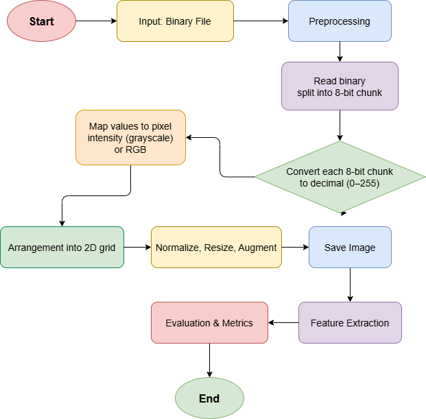
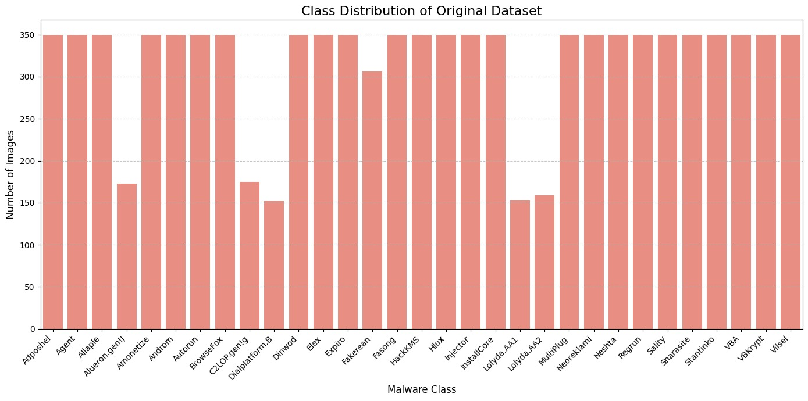
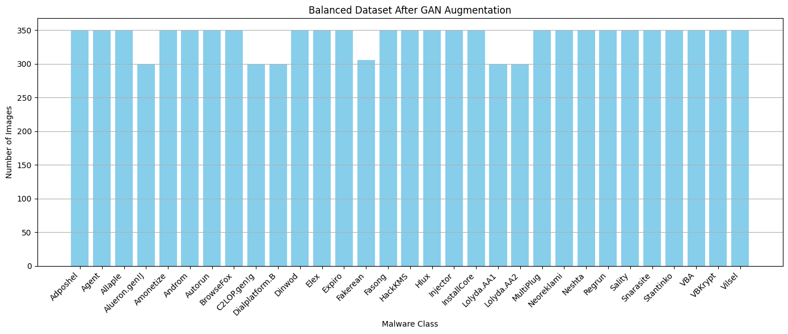
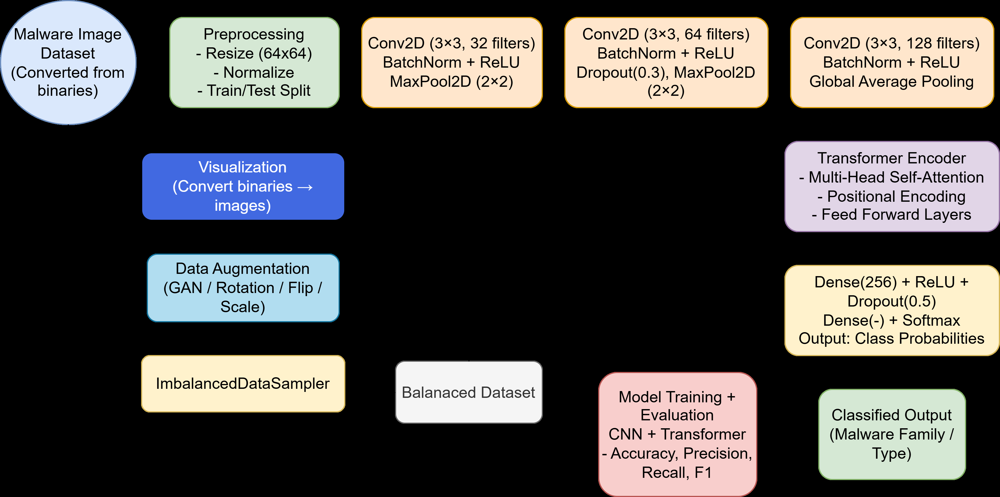
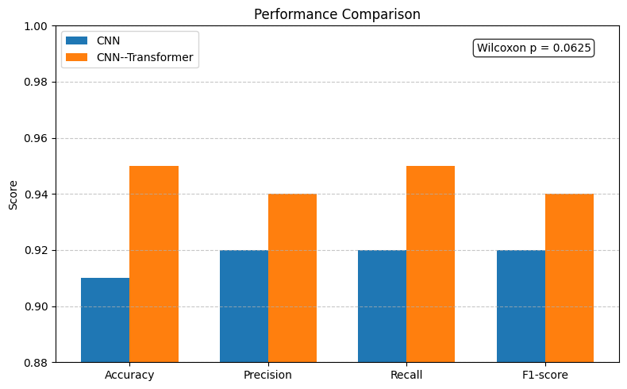
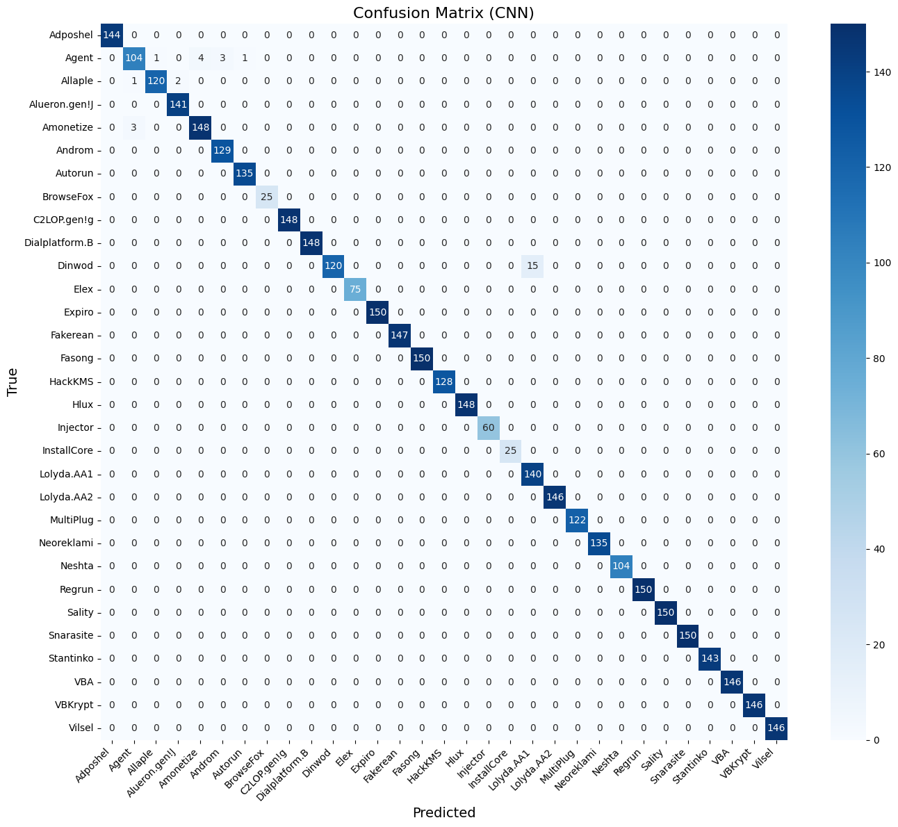
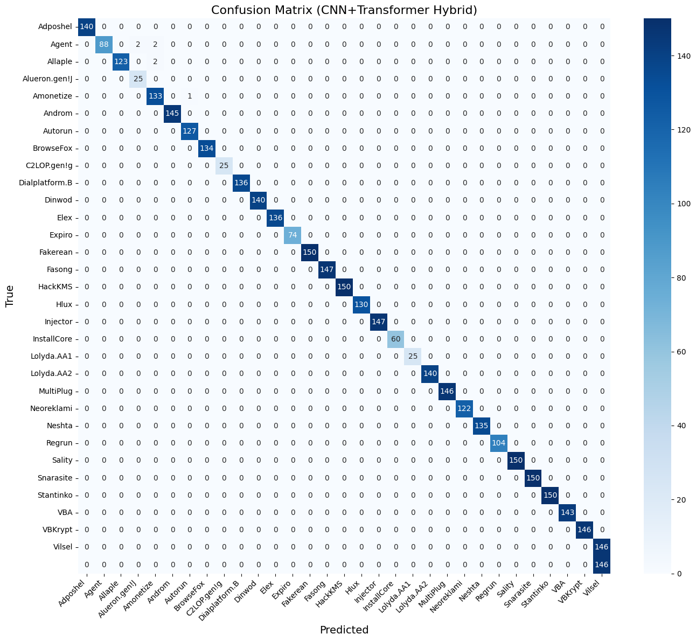
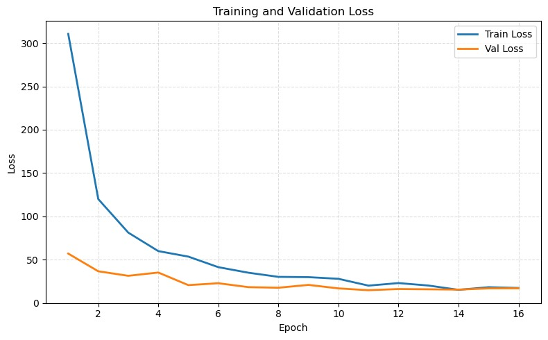

# Review Paper

### Identitas paper

#### Penulis & Tahun

Manya Dhingra, Achin Jain, Niharika Thakur, Anurag Choubey, Massimo Donelli, Arun Kumar Dubey, dan Arvind Panwar (**2026**).

#### Judul Penelitian

*Image-Based Malware Classification Using DCGAN-Augmented Data and a CNN-Transformer Hybrid Model*

#### Nama Jurnal / Conference

Artikel jurnal pada **Future Internet**, Volume 18, Article 102, tahun 2026. DOI: `10.3390/fi18020102`.

### Tujuan penelitian
Penelitian ini mengatasi ketidakseimbangan kelas pada klasifikasi citra malware dengan menghasilkan sampel sintetis menggunakan DCGAN dan menguji model hybrid CNN-Transformer.

### Dataset dan evaluasi

Penelitian menggunakan blended malware image dataset dengan karakteristik:

- sekitar **9.300 sampel**;
- **31 keluarga malware**;
- citra grayscale berukuran **64 × 64 piksel**;
- rasio ketidakseimbangan kelas lebih dari 12 kali;
- beberapa kelas minoritas hanya memiliki sekitar 25 sampel.

File executable diubah menjadi citra grayscale dengan memetakan nilai byte 0-255 menjadi intensitas piksel. DCGAN kemudian digunakan secara class-wise untuk menghasilkan citra sintetis bagi kelas minoritas hingga distribusi kelas menjadi lebih seimbang.

### Metode atau arsitektur model

Penelitian ini termasuk **computer vision untuk klasifikasi malware berbasis citra** dan menggabungkan dua komponen utama:

#### 1. DCGAN untuk Data Augmentation

DCGAN terdiri dari generator dan discriminator. Generator menghasilkan citra malware sintetis dari latent vector, sedangkan discriminator membedakan citra asli dan citra sintetis. Sampel baru dibuat khusus untuk kelas yang memiliki jumlah data rendah.

Kualitas citra sintetis dievaluasi dengan:

- Inception Score (IS): **3,43**;
- Fréchet Inception Distance (FID): **10,99**;
- Kernel Inception Distance (KID): **0,0022**.

#### 2. CNN-Transformer Hybrid

CNN digunakan untuk mengekstraksi pola lokal dan tekstur dari citra malware. Feature map berukuran 128 × 16 × 16 kemudian diubah menjadi 256 token berdimensi 128. Token tersebut diproses oleh Transformer encoder dengan 2 layer dan 4 attention head untuk memodelkan dependensi global.

Output Transformer diagregasi menggunakan global average pooling dan diteruskan ke fully connected layer untuk mengklasifikasikan 31 keluarga malware.

Resolusi 64 × 64 menghasilkan validation accuracy **95%**. Saat resolusi dinaikkan menjadi 224 × 224, training accuracy mencapai 94,17% dan validation accuracy turun menjadi 90,67%. Hasil ini menunjukkan bahwa 64 × 64 memberikan keseimbangan yang lebih baik antara informasi, noise, memori, dan efisiensi komputasi.

### Domain penelitian
Domain penelitian ini adalah **Computer Vision untuk cybersecurity**, khususnya augmentasi data dan klasifikasi malware berbasis citra.

### Hasil utama

| Dataset / Model | Accuracy | Macro Precision | Macro Recall | Macro F1-score |
| --- | ---: | ---: | ---: | ---: |
| CNN pada dataset imbalanced | 0,89 | 0,78 | 0,72 | 0,75 |
| Hybrid pada dataset imbalanced | 0,92 | 0,82 | 0,76 | 0,79 |
| CNN pada dataset DCGAN-balanced | 0,91 | 0,92 | 0,92 | 0,92 |
| Hybrid pada dataset DCGAN-balanced | **0,95** | 0,94 | **0,95** | **0,94** |

Penelitian juga melaporkan macro F1-score sekitar **0,95** pada evaluasi keseluruhan. Kelas minoritas seperti Alueron.gen!J dan Dialplatform.B mengalami peningkatan recall hingga mendekati 1,00 setelah augmentasi DCGAN.

Model hybrid memperoleh training accuracy 0,97 dan validation accuracy 0,95, sedangkan CNN baseline memperoleh training accuracy 0,91 dan validation accuracy 0,91. Selisih training-validation yang lebih kecil pada model hybrid menunjukkan konvergensi yang lebih stabil dan overfitting yang lebih rendah.

Uji Wilcoxon signed-rank pada 10 observasi berpasangan menghasilkan `p = 0,0020` untuk accuracy, precision, recall, dan F1-score. Setelah koreksi Bonferroni, hasil tersebut tetap signifikan secara statistik.

Model hybrid memiliki sekitar **6,99 juta parameter**, latency rata-rata **0,29 ms per citra**, dan throughput sekitar **3.498,29 FPS**. Hal ini menunjukkan bahwa peningkatan performa tidak menyebabkan model menjadi terlalu berat untuk penggunaan praktis.

### Analisis kontribusi model
Kontribusi utama paper adalah penggunaan DCGAN untuk memperkaya kelas minoritas serta model CNN-Transformer yang menggabungkan fitur tekstur lokal dan dependensi global. Perbandingan pada data imbalanced dan data hasil balancing mengevaluasi dampak augmentasi terhadap performa.

### Kelebihan

- Mengatasi ketidakseimbangan kelas dengan DCGAN class-wise.
- Menggabungkan keunggulan CNN untuk pola lokal dan Transformer untuk dependensi global.
- Meningkatkan performa kelas minoritas secara signifikan.
- Menghasilkan konvergensi yang lebih stabil dan overfitting yang lebih rendah.
- Memiliki jumlah parameter dan latency yang relatif rendah.
- Menyertakan evaluasi kualitas citra sintetis serta uji signifikansi statistik.

### Keterbatasan

- Kualitas citra sintetis masih bergantung pada jumlah dan keragaman sampel awal kelas minoritas.
- Kelas dengan kurang dari lima sampel tetap sulit dibuatkan data sintetis yang stabil.
- Representasi hanya menggunakan citra grayscale sehingga belum memanfaatkan API call, metadata, atau perilaku runtime.
- Ketahanan terhadap adversarial attack dan injeksi noise byte belum dievaluasi.
- Ketersediaan raw dataset bergantung pada permintaan kepada penulis.

### Kesimpulan review

Paper ini menunjukkan bahwa kombinasi DCGAN dan CNN-Transformer efektif untuk klasifikasi malware berbasis citra, terutama ketika dataset memiliki ketidakseimbangan kelas yang berat. DCGAN membantu memperkaya kelas minoritas, sementara CNN-Transformer menggabungkan pemahaman tekstur lokal dan dependensi global. Hasil terbaik mencapai accuracy 95% dan macro F1-score sekitar 0,95. Namun, penelitian lanjutan masih diperlukan untuk menguji robustness terhadap adversarial attack, malware baru, data multimodal, dan dataset lintas sumber.

### Sumber

1. Dhingra, M., Jain, A., Thakur, N., Choubey, A., Donelli, M., Dubey, A. K., & Panwar, A. (2026). *Image-Based Malware Classification Using DCGAN-Augmented Data and a CNN-Transformer Hybrid Model*. **Future Internet, 18**, 102. https://doi.org/10.3390/fi18020102
2. [Halaman sumber artikel di MDPI](https://www.mdpi.com/1999-5903/18/2/102)
