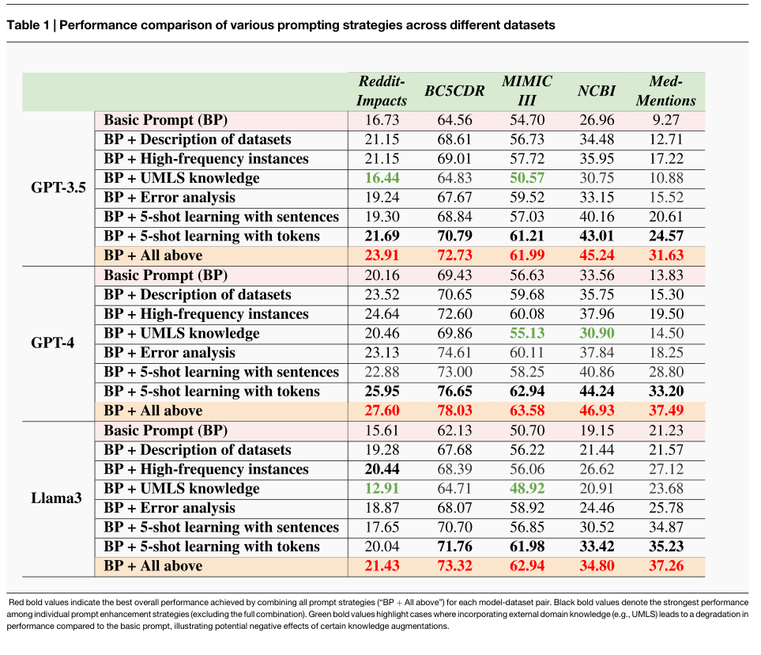
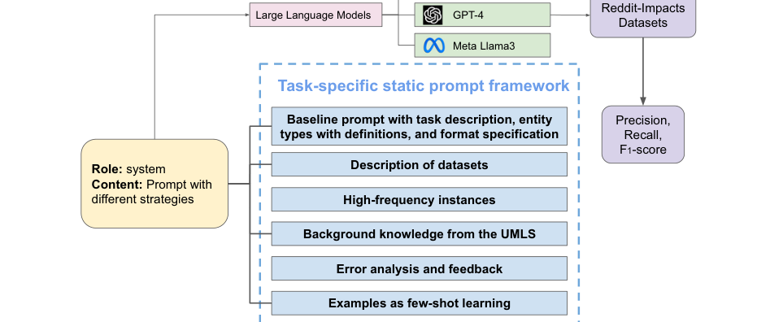
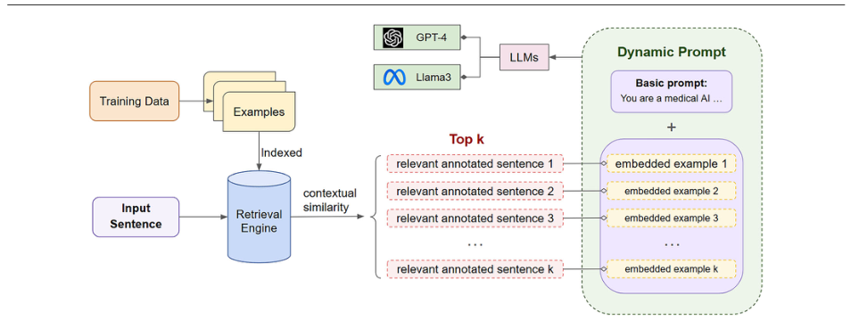
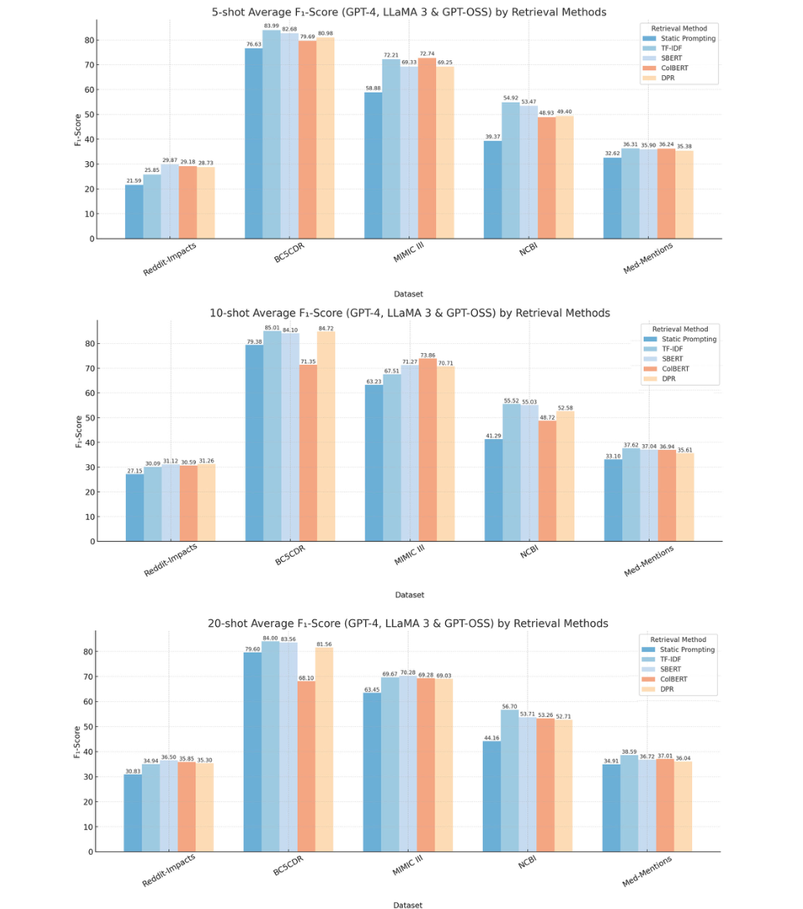

# Review Paper

### Identitas paper

#### Penulis & Tahun

Yao Ge, Yuting Guo, Sudeshna Das, dan Abeed Sarker (**2026**).

#### Judul Penelitian

*Improving Few-Shot Named Entity Recognition for Large Language Models Using Structured Dynamic Prompting with Retrieval Augmented Generation*

#### Nama Jurnal

Artikel penelitian pada **npj Artificial Intelligence**, Volume 2, Article 39, tahun 2026. Artikel tersedia secara open access.

DOI: `10.1038/s44387-025-00062-2`.

### Tujuan penelitian

Penelitian ini meningkatkan few-shot Biomedical Named Entity Recognition (NER) menggunakan structured prompting dan Retrieval-Augmented Generation (RAG). Fokusnya adalah mengurangi kebutuhan data anotasi pada domain biomedis yang memiliki istilah khusus dan perubahan domain yang besar.

### Dataset dan evaluasi

Eksperimen dilakukan pada **lima dataset biomedical NER**. Model diuji menggunakan beberapa skenario few-shot, termasuk 5-shot dan 10-shot, serta beberapa ukuran retrieval pool.

Model yang dievaluasi meliputi GPT-4, LLaMA 3-70B, dan GPT-OSS-120B. Metode retrieval yang dibandingkan mencakup TF-IDF dan pendekatan berbasis embedding.

### Metode atau arsitektur model

Penelitian membandingkan dua strategi utama:

1. **Structured static prompting**, yaitu prompt dengan komponen yang dirancang secara sistematis.
2. **Structured dynamic prompting**, yaitu prompt yang diperbarui secara dinamis menggunakan contoh anotasi paling relevan dari retrieval engine.

Komponen structured prompt meliputi task description, definisi entitas, contoh few-shot, input sentence, entity type, serta format jawaban yang diharapkan.

Pada dynamic prompting, annotated examples dari training set diindeks terlebih dahulu. Saat inference, sistem melakukan retrieval berdasarkan kemiripan konteks, lalu memasukkan contoh terpilih ke dalam prompt sebelum dikirimkan ke LLM.

### Domain penelitian

Domain penelitian ini adalah **Natural Language Processing (NLP)**. Paper ini berfokus pada **Biomedical Named Entity Recognition**, yaitu mengenali entitas biomedis seperti:

- penyakit;
- obat dan adverse drug reaction;
- perawatan atau treatment;
- gejala;
- konsep klinis lainnya.

### Hasil utama

Structured static prompting meningkatkan rata-rata F1-score sebesar:

- **12% pada GPT-4**;
- **11% pada GPT-3.5 dan LLaMA 3-70B**;

dibandingkan basic static prompting.

Dynamic prompting dengan retrieval TF-IDF menghasilkan peningkatan rata-rata F1-score sebesar:

| Skenario | Peningkatan rata-rata F1-score |
| --- | ---: |
| 5-shot | **8,8%** |
| 10-shot | **6,3%** |

Hasil ablation study menunjukkan bahwa performa yang kuat masih dapat dicapai dengan jumlah annotated examples yang relatif kecil.

### Analisis kontribusi model

Kontribusi utama penelitian ini adalah:

- menyusun prompt dengan komponen yang terstruktur;
- memilih contoh few-shot secara dinamis berdasarkan input;
- menggabungkan retrieval dengan prompting tanpa harus melatih ulang LLM;
- mengurangi ketergantungan pada dataset anotasi biomedis berukuran besar;
- mengevaluasi metode pada beberapa LLM dan dataset biomedical NER.

### Kelebihan

- Menggabungkan dua tren NLP yang banyak digunakan: dynamic prompting dan RAG.
- Relevan untuk biomedical NLP dengan data anotasi terbatas.
- Tidak memerlukan fine-tuning penuh terhadap LLM.
- Menguji beberapa model, metode retrieval, dan skenario few-shot.
- Memiliki ablation study terhadap ukuran retrieval pool.

### Keterbatasan

- Kinerja masih bergantung pada kualitas retrieval engine dan contoh anotasi.
- Pemanggilan LLM dan proses retrieval dapat meningkatkan latensi.
- Hasil pada domain biomedis belum tentu langsung berlaku pada domain umum.
- Penggunaan model komersial seperti GPT-4 dapat meningkatkan biaya eksperimen.

### Kesimpulan review

Structured dynamic prompting berbasis RAG meningkatkan few-shot Biomedical NER dengan mengambil contoh anotasi yang paling relevan terhadap input. Strategi ini menghasilkan peningkatan F1-score dibandingkan static prompting dan menunjukkan bahwa pemilihan konteks secara dinamis dapat mengurangi kebutuhan anotasi. Namun, kualitas retrieval, biaya pemanggilan LLM, dan ketergantungan pada domain biomedis tetap menjadi faktor yang perlu dipertimbangkan.

### Sumber

1. Ge, Y., Guo, Y., Das, S., & Sarker, A. (2026). *Improving Few-Shot Named Entity Recognition for Large Language Models Using Structured Dynamic Prompting with Retrieval Augmented Generation*. **npj Artificial Intelligence, 2**, 39. https://doi.org/10.1038/s44387-025-00062-2
2. [Halaman artikel dan PDF gratis](https://www.nature.com/articles/s44387-025-00062-2)
