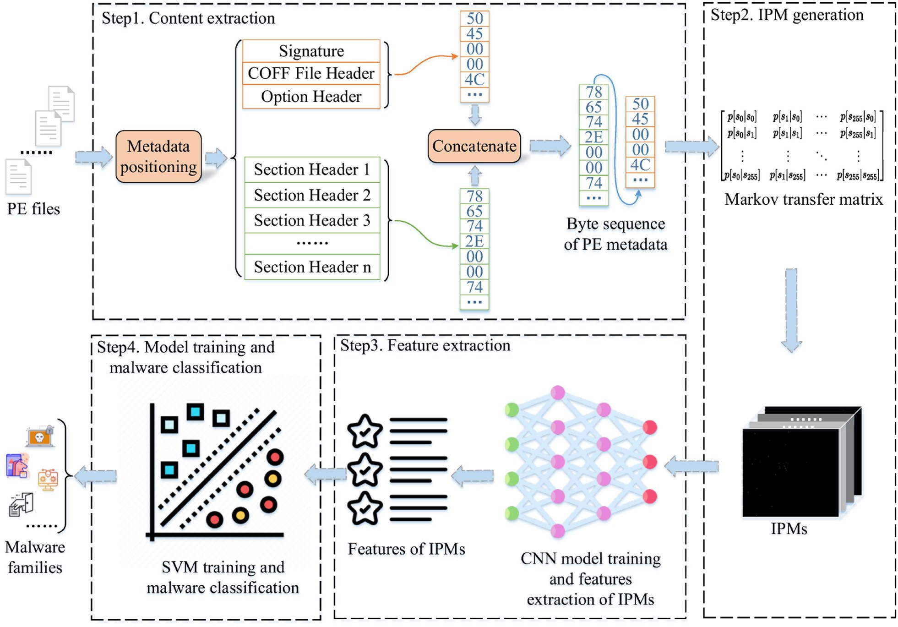
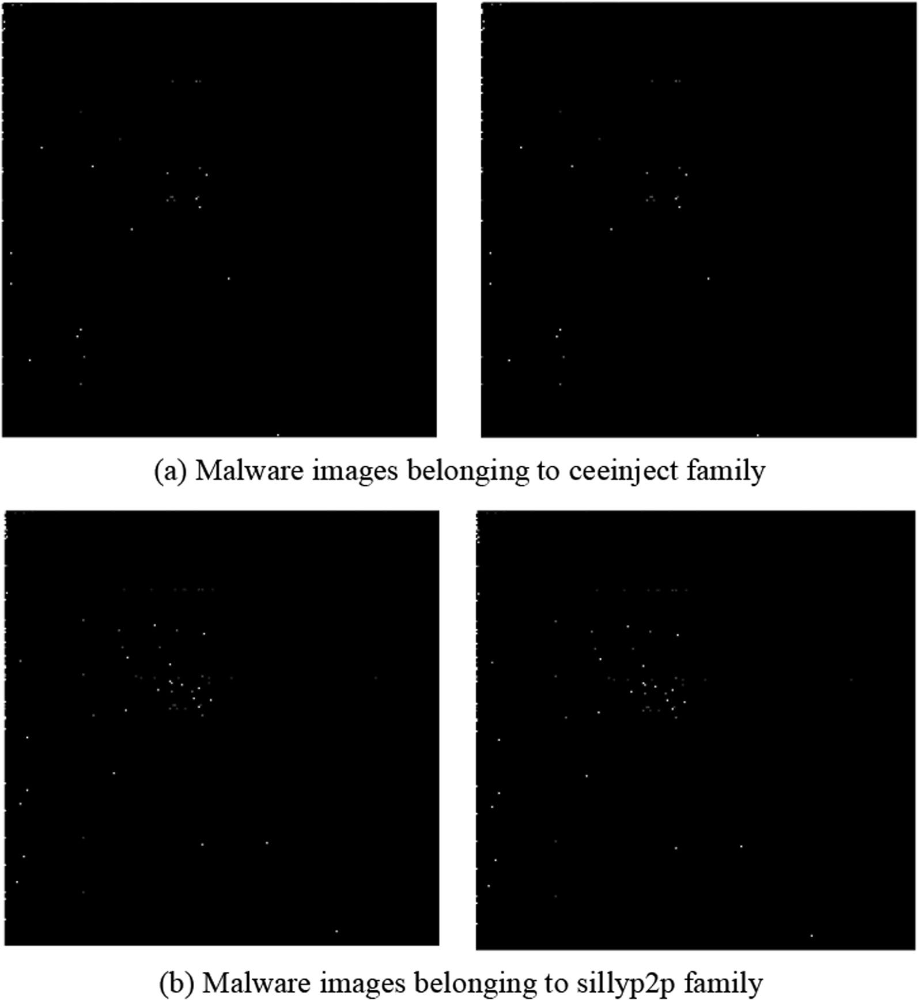
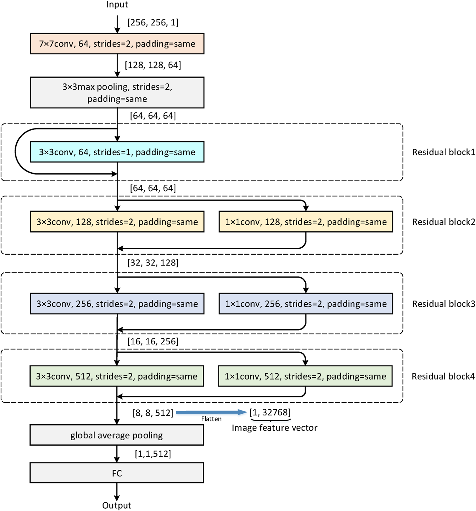
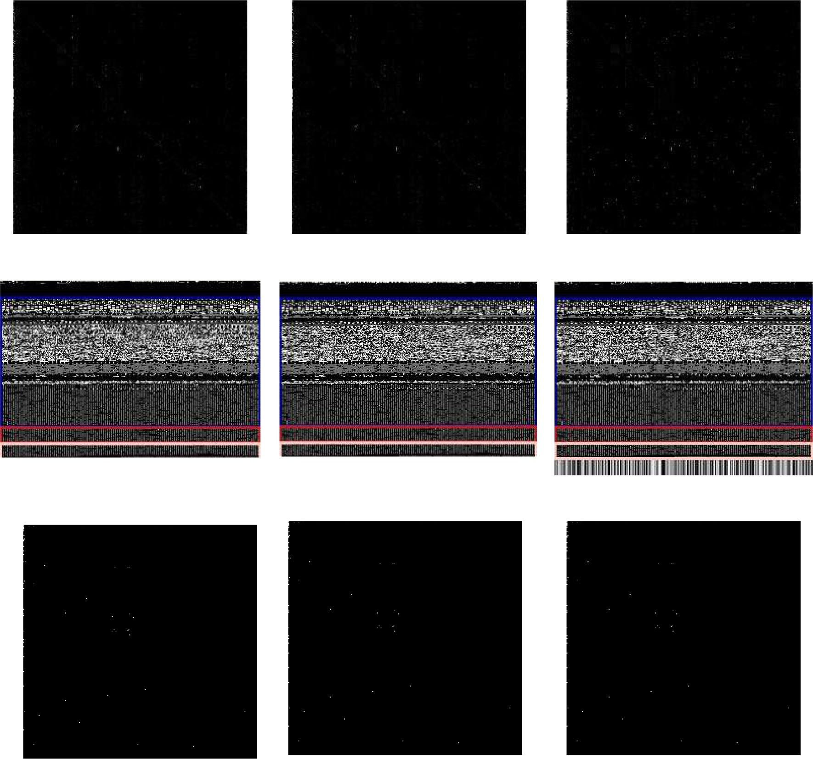
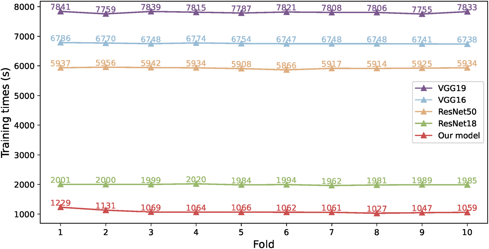

# Review Paper

### Identitas paper

#### Penulis & Tahun

Yonglin Zhao, Chun Guo, Yuan Ping, Yi Chen, Yunhe Cui, dan Guowei Shen (**2026**).

#### Judul Penelitian

*MCPDS: Image-Based Malware Classification Method Using PE Metadata Alone*

#### Nama Jurnal / Conference

Artikel penelitian pada **Cybersecurity**, Volume 9, Article 34, tahun 2026. DOI: `10.1186/s42400-025-00455-5`.

### Tujuan penelitian
Penelitian ini mengembangkan klasifikasi citra malware statis dari metadata PE dan mengevaluasi akurasi, efisiensi pembentukan citra, serta ketahanan terhadap perubahan adversarial pada byte.

### Dataset dan evaluasi

Penelitian menggunakan dataset **BODMAS** karena dataset ini menyediakan file PE lengkap yang dibutuhkan untuk mengekstrak PE metadata.

| Dataset | Isi |
| --- | --- |
| Dataset1 | 18.498 sampel dari 10 keluarga malware |
| Dataset2 | 4.000 sampel dari 10 keluarga malware |
| BODMAS keseluruhan | 57.293 sampel dari 581 keluarga malware |

Dataset2 mencakup keluarga Bifrose, Hupigon, Obfuscated, Vapsup, Hmir, Zlob, OnLineGames.aro, OnLineGames.blh, Pophot, dan Zbot.

| Extracted content | Accuracy | Macro Precision | Macro Recall | Macro F1 | Waktu generasi |
| --- | ---: | ---: | ---: | ---: | ---: |
| Entire PE file | 98,79% | 98,69% | 99,20% | 98,90% | 1,78 detik |
| Code section | 98,32% | 98,25% | 98,95% | 98,51% | 0,24 detik |
| **PE metadata / IPM** | **98,82%** | **98,72%** | **99,26%** | **98,94%** | **0,19 detik** |

Pada Dataset1, CNN MCPDS memiliki accuracy 98,82% dan macro F1-score 98,94%. Model juga memiliki jumlah parameter serta FLOPs lebih rendah daripada VGG16, VGG19, ResNet18, dan ResNet50.

| Extracted content | Accuracy | Macro Precision | Macro Recall | Macro F1 | Waktu generasi |
| --- | ---: | ---: | ---: | ---: | ---: |
| Entire PE file | 95,60% | 95,56% | 94,32% | 94,79% | 0,21 detik |
| Code section | 94,55% | 94,68% | 93,66% | 94,01% | 0,19 detik |
| **PE metadata / IPM** | **95,80%** | **95,54%** | **95,45%** | **95,41%** | **0,09 detik** |

Pada perbandingan metode Dataset2, MCPDS memperoleh accuracy 95,80% dan macro F1-score 95,41%, lebih tinggi daripada MDMC, MalCVS, MulMarkov, MCTVD, VCFR, dan HCDNN.

### Metode atau arsitektur model

Paper ini termasuk **computer vision untuk klasifikasi malware berbasis citra** dengan analisis statis. MCPDS terdiri dari empat tahap:

1. **Content extraction**: mengekstrak PE header dan section table dari file PE. Keduanya disebut sebagai PE metadata.
2. **IPM generation**: mengubah byte sequence PE metadata menjadi Markov transfer matrix, lalu memetakan probabilitas transisi menjadi nilai piksel 0-255.
3. **Feature extraction**: menggunakan CNN dangkal yang terdiri dari 5 convolutional layer, 2 pooling layer, dan 1 fully connected layer.
4. **Classification**: feature vector berdimensi 32.768 diklasifikasikan menggunakan SVM dengan Gaussian kernel.

Berbeda dari metode yang menggunakan seluruh byte file atau kode hasil disassembly, IPM hanya menggunakan PE header dan section table. Pendekatan ini mengurangi waktu pembuatan citra sekaligus mempertahankan informasi yang cukup untuk membedakan keluarga malware.

CNN yang dirancang penulis digunakan sebagai feature extractor, bukan sebagai classifier akhir. Model menggunakan kombinasi max pooling dan global average pooling. Setelah training, output residual block 4 digunakan sebagai fitur citra.

| Metode | CPU usage | Memory usage | Inference |
| --- | ---: | ---: | ---: |
| MDMC | 46,67% | 5,46% | 0,43 detik |
| **MCPDS** | **17,93%** | 13,49% | **0,38 detik** |

### Domain penelitian
Domain penelitian ini adalah **Computer Vision untuk cybersecurity**, khususnya klasifikasi malware berbasis citra yang dibentuk dari metadata PE.

### Hasil utama

| Representasi | Accuracy | Macro F1 |
| --- | ---: | ---: |
| Grayscale | 98,02% | 98,16% |
| RGB | 98,39% | 98,51% |
| Markov | 98,79% | 98,90% |
| Multidimensional Markov | 98,80% | 98,90% |
| **IPM** | **98,82%** | **98,94%** |

MCPDS diuji menggunakan dua teknik adversarial berbasis byte:

- **Full DOS**, yaitu perubahan byte pada area DOS header dan PE header;
- **Padding**, yaitu penambahan byte redundan pada akhir file dengan rasio 0,1.

MCPDS mempertahankan accuracy dan seluruh macro metrics pada Dataset2, yaitu accuracy 95,80% dan macro F1-score 95,41%, baik pada kondisi normal, Full DOS, maupun padding. Hal ini terjadi karena kedua teknik tersebut tidak mengubah byte PE metadata yang digunakan untuk membuat IPM.

### Analisis kontribusi model
Kontribusi utama MCPDS adalah skema pengodean metadata PE menjadi Image of PE Metadata (IPM), diikuti ekstraksi fitur CNN dan klasifikasi SVM. Paper membandingkan IPM dengan representasi grayscale, RGB, Markov, dan multidimensional Markov, serta menguji robustness terhadap manipulasi byte.

### Kelebihan

- Menghasilkan citra malware tanpa proses disassembly.
- Waktu generasi IPM lebih cepat karena hanya memakai PE metadata.
- Menggunakan CNN dangkal dan SVM sehingga lebih efisien daripada model CNN besar.
- Memperoleh akurasi dan macro F1 yang tinggi pada dua dataset.
- Robust terhadap Full DOS dan padding attack yang tidak mengubah PE metadata.
- Memiliki konsumsi CPU dan inference time yang rendah pada perangkat terbatas.

### Keterbatasan

- Performa bergantung pada kemiripan PE metadata malware baru dengan data training.
- Packing dapat mengubah PE metadata dan menurunkan kemampuan klasifikasi.
- Penyerang masih dapat memodifikasi PE metadata secara langsung untuk menghasilkan adversarial sample.
- Metode belum secara penuh menangani malware packed; deteksi dan unpacking menjadi pekerjaan lanjutan.
- Penggunaan PE metadata saja dapat mengabaikan informasi penting dari section code dan perilaku runtime.

### Kesimpulan review

MCPDS menunjukkan bahwa PE metadata saja dapat digunakan untuk membangun citra malware yang informatif. Dengan IPM, CNN dangkal, dan SVM, metode ini mencapai accuracy 98,82% pada Dataset1 dan 95,80% pada Dataset2, sekaligus mengurangi waktu generasi citra. Pendekatan ini menarik untuk klasifikasi malware yang membutuhkan efisiensi tinggi, tetapi robustness terhadap packing dan manipulasi PE metadata masih perlu diteliti lebih lanjut.

### Sumber

1. Zhao, Y., Guo, C., Ping, Y., Chen, Y., Cui, Y., & Shen, G. (2026). *MCPDS: image-based malware classification method using PE metadata alone*. **Cybersecurity, 9**, 34. https://doi.org/10.1186/s42400-025-00455-5
2. [Sumber artikel di ResearchGate](https://www.researchgate.net/publication/401156653_MCPDS_image-based_malware_classification_method_using_PE_metadata_alone)
