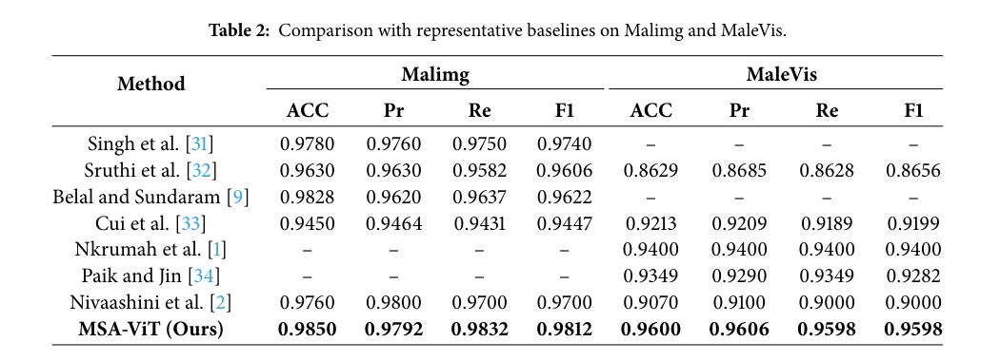
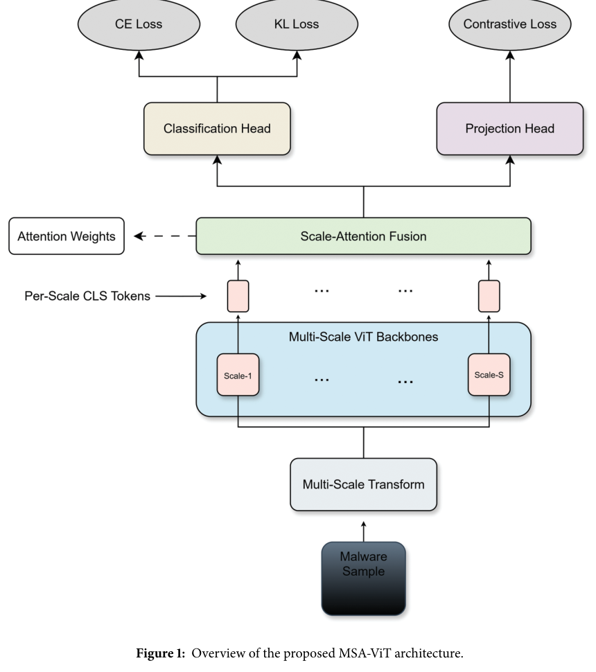
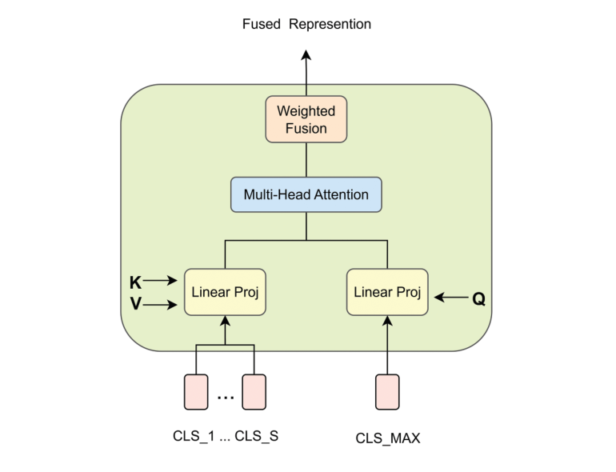
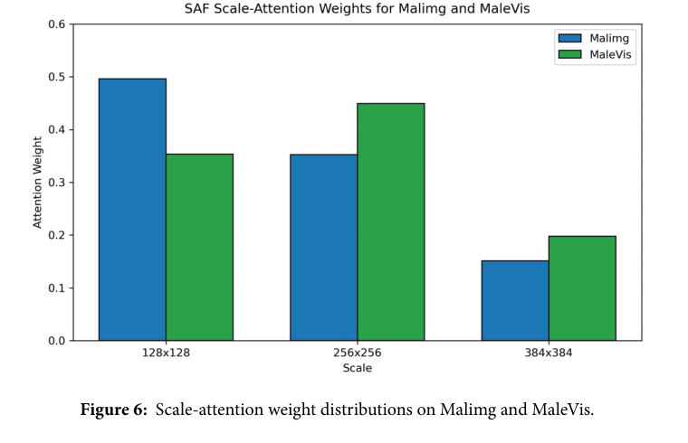

# Review Paper

## MSA-ViT: A Multi-Scale Vision Transformer for Robust Malware Image Classification

### Identitas paper

- **Penulis:** Bofan Yang, Bingbing Li, dan Chuanping Hu
- **Tahun:** 2026
- **Publikasi:** *Computers, Materials & Continua*, volume 87, nomor 3, artikel 51.
- **DOI:** [10.32604/cmc.2026.077697](https://doi.org/10.32604/cmc.2026.077697)
- **Tanggal publikasi edisi:** 9 April 2026.

### Tujuan penelitian

Penelitian ini mengusulkan MSA-ViT untuk klasifikasi citra malware dengan tujuan menggabungkan informasi pada beberapa resolusi dan mengurangi penurunan performa akibat perubahan skala, padding, dan perturbasi. Penulis menyoroti ketergantungan model ViT biasa pada resolusi masukan yang tetap.

### Dataset dan evaluasi

Penulis mengevaluasi model pada dua dataset citra malware:

- **Malimg:** 9.339 citra grayscale dari 25 keluarga malware; citra grayscale direplikasi menjadi tiga kanal untuk masukan ViT.
- **MaleVis:** 14.226 citra RGB dari 26 kelas, meliputi 25 keluarga malware dan satu kelas benign.

Data dibagi secara stratified menjadi 70% train dan 30% test. Metrik yang dilaporkan mencakup accuracy, precision, recall, F1-score, Matthews Correlation Coefficient (MCC), micro/macro AUC, dan confusion matrix. Eksperimen menggunakan PyTorch 2.5.0, CUDA 13.0, dan NVIDIA A100 40 GB. Paper melaporkan biaya inferensi 3,1 GFLOPs.

*Tabel 2 membandingkan metrik MSA-ViT dan metode terdahulu pada Malimg dan MaleVis. Tanda “–” berarti hasil tidak dicantumkan pada tabel paper. Sumber: Yang et al. (2026), Tabel 2.*

### Metode atau arsitektur model

MSA-ViT menggunakan backbone ViT-B/16 terpisah untuk tiga resolusi masukan: 128 × 128, 256 × 256, dan 384 × 384. Token CLS dari cabang resolusi terbesar digunakan sebagai query dalam **Scale-Attention Fusion (SAF)**, sedangkan token CLS semua skala menjadi key dan value. SAF mempelajari bobot kontribusi tiap skala dan menggabungkannya tanpa mengubah blok internal ViT.

Pelatihan dilakukan dalam dua tahap. Tahap pertama menggunakan pretraining self-supervised SimCLR; tahap kedua melakukan fine-tuning terawasi dengan cross-entropy dan regularisasi konsistensi antar-skala berbasis KL-divergence. Kepala proyeksi dipakai untuk SimCLR, sedangkan kepala klasifikasi dipakai untuk prediksi malware. Penulis menyebut AdamW, learning rate 5 × 10⁻⁴, batch 256, serta 200 epoch untuk pretraining SimCLR dan maksimum 150 epoch fine-tuning setelah warm-up 10 epoch.

*Arsitektur memperlihatkan transformasi multi-skala, beberapa backbone ViT, SAF, dan kepala klasifikasi/proyeksi. Sumber: Yang et al. (2026), Gambar 1.*

*Diagram internal modul SAF. Sumber: Yang et al. (2026), Gambar 2.*

### Domain penelitian

**Computer vision untuk cybersecurity**, khususnya klasifikasi malware berbasis citra grayscale/RGB dan evaluasi robustness terhadap perubahan citra.

### Hasil utama

| Dataset | Accuracy | Precision | Recall | F1-score | AUC micro/macro |
|---|---:|---:|---:|---:|---:|
| Malimg | 98,50% | 97,92% | 98,32% | 98,12% | 0,99 / 0,99 |
| MaleVis | 96,00% | 96,06% | 95,98% | 95,98% | 0,98 / 0,98 |

Pada Tabel 2, MSA-ViT mencatat nilai tertinggi di antara angka yang dicantumkan untuk accuracy, recall, dan F1 pada Malimg; precision Malimg-nya 97,92%, sedikit di bawah 98,00% yang dicantumkan untuk Nivaashini et al. Pada MaleVis, MSA-ViT mencapai metrik tertinggi di antara metode yang tabelnya memuat hasil MaleVis. Ablation study melaporkan bahwa konfigurasi satu skala menurunkan accuracy sekitar 2,4 poin persentase pada masing-masing dataset dibanding konfigurasi tiga skala. Pengujian scaling, padding, dan FGSM dilaporkan menghasilkan penurunan accuracy di bawah 1,8%.

*Bobot perhatian menunjukkan kontribusi skala berbeda pada Malimg dan MaleVis. Sumber: Yang et al. (2026), Gambar 6.*

### Analisis kontribusi model

Kontribusi utama paper adalah menggabungkan masukan multi-resolusi dengan fusi lintas skala yang bobotnya dipelajari melalui perhatian, bukan sekadar menggabungkan fitur secara statis. Regularisasi konsistensi KL dan pretraining SimCLR melengkapi desain tersebut. Eksperimen ablation mendukung kontribusi masukan tiga skala dan SAF terhadap hasil yang dilaporkan. Karena MaleVis memuat citra RGB dan termasuk dataset evaluasi, paper ini juga memberi contoh penerapan ViT pada klasifikasi malware RGB. Namun, paper ini tidak membandingkan ViT dengan Vision Mamba.

### Kelebihan

1. Mengevaluasi pada Malimg dan MaleVis serta melaporkan beberapa metrik selain accuracy.
2. Menguji ketahanan terhadap perubahan skala, padding, dan perturbasi FGSM, serta menyertakan ablation study.
3. Melaporkan ukuran komputasi inferensi dan konfigurasi pelatihan.
4. Menggunakan RGB asli MaleVis dan menjelaskan bahwa uji FGSM dilakukan pada representasi citra, bukan pada executable.
5. Menyediakan visualisasi bobot SAF untuk menunjukkan skala yang berkontribusi pada prediksi.

### Keterbatasan

1. Evaluasi menggunakan satu pembagian stratified 70:30; paper tidak melaporkan pengulangan dengan beberapa seed atau validasi silang.
2. Robustness FGSM berlaku pada tingkat citra; perturbasi piksel tersebut belum tentu menghasilkan executable yang valid atau tetap berfungsi.
3. Penulis menyatakan bahwa skala input yang tetap dapat kurang sesuai untuk sampel dengan variasi ukuran yang ekstrem.
4. Eksperimen hanya membahas representasi statis dan tidak menggabungkan perilaku dinamis malware.
5. Ketersediaan data dinyatakan “by request from the authors”, sehingga akses dan reproduksi data bergantung pada permintaan kepada penulis.
6. MSA-ViT adalah model ViT multi-skala yang dimodifikasi; angka hasilnya bukan hasil baseline ViT standar dan tidak menjadi perbandingan langsung dengan Vision Mamba.

### Kesimpulan review

MSA-ViT menggabungkan tiga resolusi citra malware menggunakan backbone ViT, modul SAF, pretraining SimCLR, dan regularisasi konsistensi skala. Paper melaporkan accuracy 98,50% pada Malimg dan 96,00% pada MaleVis serta penurunan accuracy di bawah 1,8% pada perturbasi citra yang diuji. Temuan ini relevan sebagai studi ViT untuk klasifikasi malware, termasuk citra RGB MaleVis. Interpretasi hasil robustness perlu dibatasi pada representasi citra, dan hasilnya tidak dapat digunakan sebagai perbandingan langsung dengan Vision Mamba tanpa eksperimen dalam protokol yang sama.

### Sumber

1. Yang, B., Li, B., & Hu, C. (2026). *MSA-ViT: A Multi-Scale Vision Transformer for Robust Malware Image Classification*. **Computers, Materials & Continua, 87**(3), artikel 51. [Halaman artikel](https://www.techscience.com/cmc/v87n3/66976) · [DOI](https://doi.org/10.32604/cmc.2026.077697).
2. [PDF artikel dari Tech Science Press](https://www.techscience.com/cmc/v87n3/66976/pdf).
