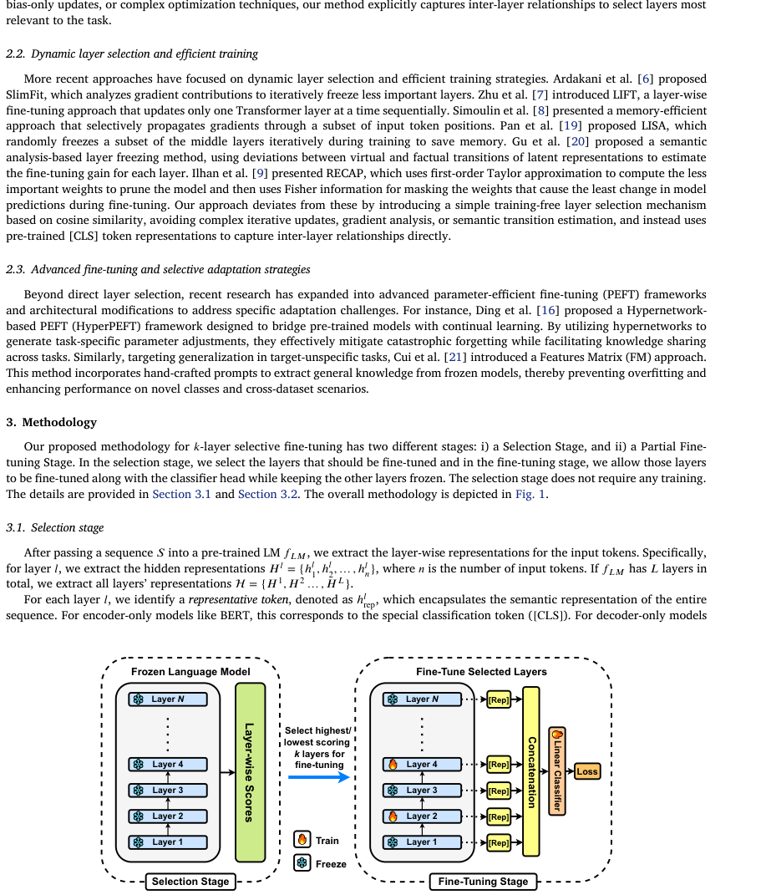
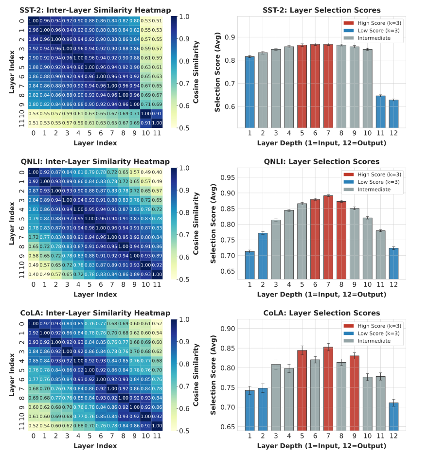
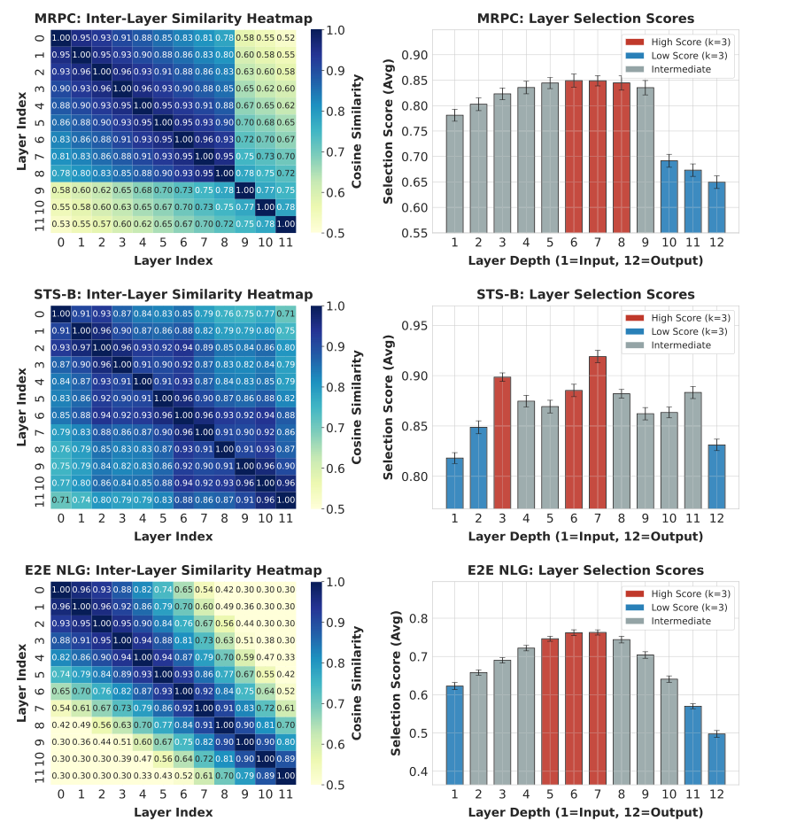
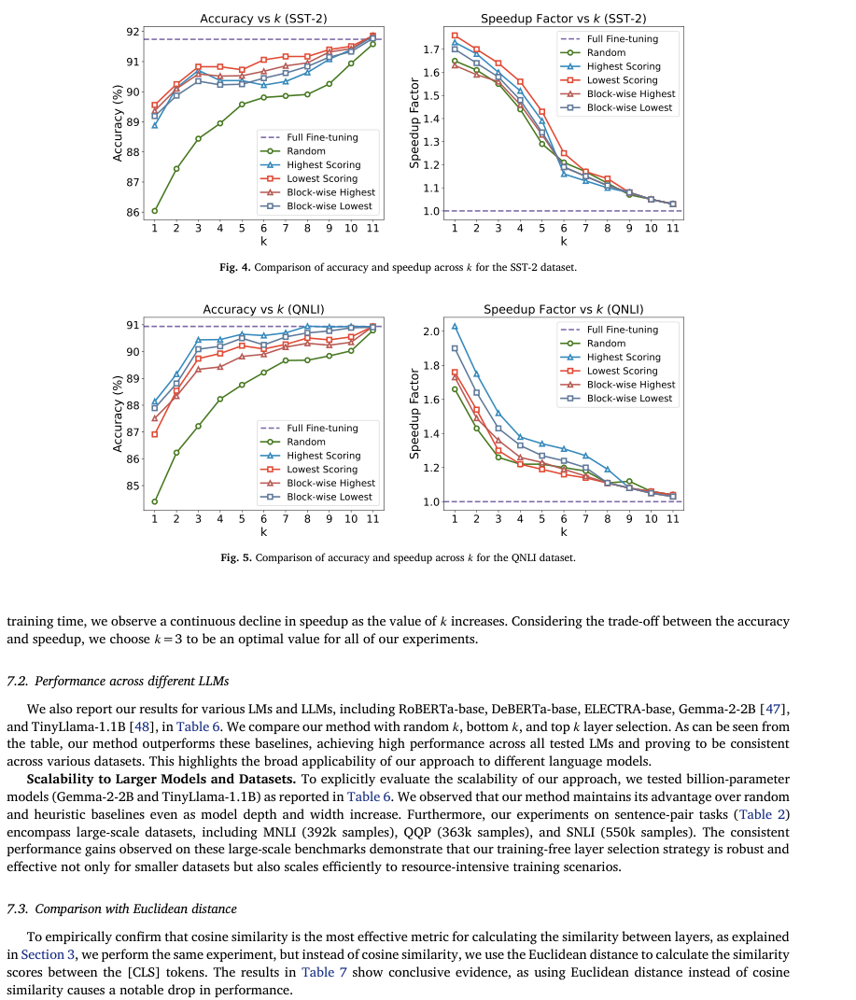

# Review Paper

## Training-Free Layer Selection for Partial Fine-Tuning of Language Models

### Penulis & Tahun

Aldrin Kabya Biswas, Md Fahim, Md Tahmid Hasan Fuad, Akm Moshiur Rahman Mazumder, Amin Ahsan Ali, dan AKM Mahbubur Rahman (**2026**).

### Judul Penelitian

*Training-Free Layer Selection for Partial Fine-Tuning of Language Models*

### Nama Jurnal

Artikel penelitian pada **Information Sciences**, Volume 740, Article 123204, tahun 2026. Artikel tersedia secara open access.

DOI: `10.1016/j.ins.2026.123204`.

### Tujuan Penelitian

Penelitian ini mengurangi biaya fine-tuning pada pretrained language model dengan memilih hanya layer Transformer yang paling relevan untuk tugas tertentu. Tujuannya adalah mengurangi jumlah parameter trainable dan mempercepat training tanpa penurunan performa yang besar.

### Dataset dan Evaluasi

Metode diuji pada **16 dataset NLP** yang mencakup:

- klasifikasi single-sentence;
- klasifikasi sentence-pair;
- semantic similarity;
- natural language inference;
- text generation.

Evaluasi membandingkan akurasi, jumlah parameter yang dilatih, training speedup, dan ketahanan terhadap perubahan domain.

### Metode / Model

Metode yang diusulkan menggunakan dua tahap utama:

1. **Selection stage**: menghitung cosine similarity token representatif antar-layer melalui satu forward pass untuk mendapatkan layer selection score.
2. **Partial fine-tuning stage**: hanya melatih layer dengan skor tertinggi, terendah, atau pola block-wise, sementara layer lainnya dibekukan.

Token representatif dapat berupa token `[CLS]` pada model encoder atau token terakhir pada model decoder. Dengan demikian, pemilihan layer tidak memerlukan training tambahan.

### Strategi Pemilihan Layer

Penelitian membandingkan beberapa strategi:

- **Highest-scoring layers**;
- **Lowest-scoring layers**;
- **Block-wise selection**;
- full fine-tuning sebagai pembanding.

Pola layer yang optimal berbeda-beda bergantung pada tugas. Beberapa tugas lebih terbantu oleh layer awal dan tengah, sedangkan tugas lain memperoleh hasil lebih baik dari layer dengan skor rendah atau pemilihan block-wise.

### Tugas NLP

Paper ini berfokus pada efisiensi fine-tuning untuk berbagai tugas NLP berbasis pretrained language model, termasuk klasifikasi teks, natural language inference, semantic similarity, dan text generation.

### Hasil Utama

Hasil penelitian menunjukkan bahwa metode yang diusulkan:

| Indikator | Hasil |
| --- | ---: |
| Pengurangan parameter trainable | **75%** |
| Rata-rata training speedup | **1,5 kali** |
| Dataset yang mengungguli baseline | **14 dari 16** |

Metode juga tidak menunjukkan penurunan performa yang berarti ketika model dievaluasi pada domain yang berbeda.

### Analisis Kontribusi Model

Kontribusi utama penelitian ini adalah:

- pemilihan layer tanpa training tambahan;
- pemanfaatan hubungan token antar-layer;
- pengurangan parameter yang perlu di-update;
- kompatibilitas dengan model encoder dan decoder;
- pengujian pada tugas klasifikasi dan generasi.

### Kelebihan

- Mengusulkan strategi pemilihan layer berbasis analisis representasi.
- Mengurangi kebutuhan memori dan waktu training.
- Tidak memerlukan proses pencarian layer berbasis trial-and-error yang panjang.
- Diuji pada 16 dataset NLP yang beragam.
- Mempertahankan generalisasi lintas domain.

### Keterbatasan

- Pola layer optimal berbeda-beda untuk setiap tugas.
- Cosine similarity token belum tentu selalu merepresentasikan kontribusi semantik setiap layer.
- Evaluasi pada model dan arsitektur yang lebih besar masih perlu diperluas.
- Partial fine-tuning dapat memerlukan pencarian strategi selection yang sesuai.

### Kesimpulan Review

Training-free layer selection menggunakan cosine similarity antar-layer untuk menentukan bagian Transformer yang paling relevan terhadap tugas downstream. Partial fine-tuning berdasarkan skor tersebut mengurangi parameter trainable, mempercepat training, dan mempertahankan performa pada berbagai tugas NLP. Efektivitas metode tetap bergantung pada pola representasi tiap tugas, sehingga strategi pemilihan layer perlu dievaluasi sebelum diterapkan pada model atau domain baru.

### Sumber

1. Biswas, A. K., Fahim, M., Fuad, M. T. H., Mazumder, A. M. R., Ali, A. A., & Rahman, A. M. (2026). *Training-Free Layer Selection for Partial Fine-Tuning of Language Models*. **Information Sciences, 740**, 123204. https://doi.org/10.1016/j.ins.2026.123204
2. [Halaman artikel dan PDF gratis](https://www.sciencedirect.com/science/article/pii/S0020025526001350)
