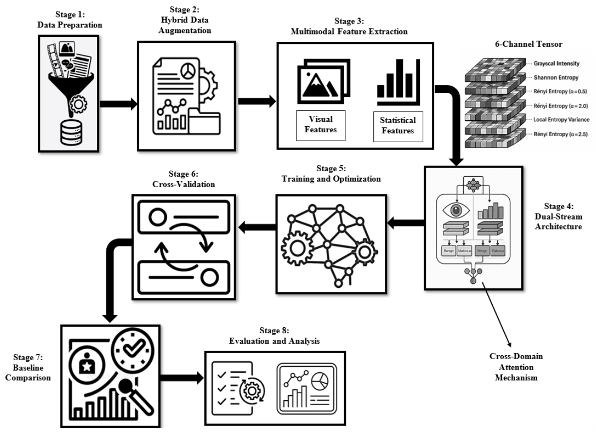
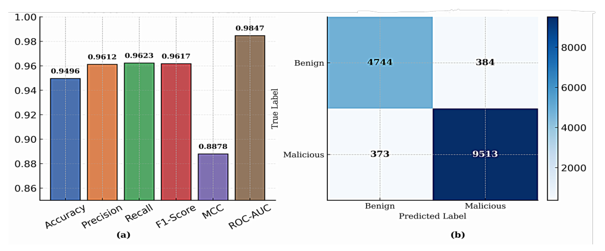
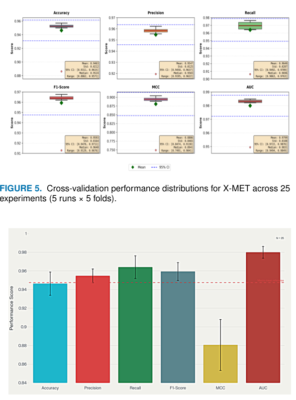

# Review Paper

## X-MET: Multimodal Entropy–Visual Deep Learning Technique for Strengthening Cyber Governance and Resilient Digital Infrastructure

### Identitas paper

- **Penulis:** N. S. Sneha, K. Krishna Prakasha, dan Srikanth Prabhu.
- **Tahun:** 2026.
- **Publikasi:** *IEEE Access*, volume 14, hlm. 27972–27992.
- **DOI:** [10.1109/ACCESS.2026.3666249](https://doi.org/10.1109/ACCESS.2026.3666249).
- **Sumber:** [ResearchGate](https://www.researchgate.net/publication/400965348_X-MET_Multimodal_Entropy-Visual_Deep_Learning_Technique_for_Strengthening_Cyber_Governance_and_Resilient_Digital_Infrastructure) · [PDF pada ResearchGate](https://www.researchgate.net/publication/400965348_X-MET_Multimodal_Entropy-Visual_Deep_Learning_Technique_for_Strengthening_Cyber_Governance_and_Resilient_Digital_Infrastructure/fulltext/6997abed64ca8a38208eff41/X-MET_Multimodal-Entropy-Visual-Deep-Learning-Technique-for-Strengthening-Cyber-Governance-and-Resilient-Digital-Infrastructure.pdf) · [DOI](https://doi.org/10.1109/ACCESS.2026.3666249).
- **Catatan versi:** Metadata publikasi mencatat artikel terbit di *IEEE Access* volume 14 pada 2026. PDF lokal yang ditinjau adalah salinan accepted-author yang masih memuat teks template IEEE dan placeholder DOI pada halaman pertama.

### Tujuan penelitian

Paper mengusulkan X-MET, metode deteksi malware statis lintas format yang menggabungkan pola visual byteplot grayscale dengan fitur entropi. Tujuannya menangkap struktur spasial berkas sekaligus variasi statistik lokal yang mungkin berkaitan dengan packing, kompresi, enkripsi, atau obfuscation.

### Dataset dan evaluasi

Penulis menyusun korpus dari sumber malware dan benign yang disebut mencakup 11 format berkas. Abstrak menyebut 408.000 sampel awal dan 100.253 sampel terpilih setelah stratified sampling serta augmentasi selektif. Kelas berisi 93.513 HTML dari 100.253 sampel akhir, sehingga komposisi lintas format sangat didominasi HTML. Data dibagi menjadi training, validation, dan fixed held-out test; penulis juga melaporkan repeated stratified five-fold cross-validation dengan lima seed, berjumlah 25 evaluasi.

Pada held-out test, paper melaporkan accuracy 94,96%, F1 0,9617, dan AUROC 0,9847. Ringkasan 25 evaluasi cross-validation melaporkan mean F1 0,9593 dan mean recall 0,9640. Tabel per-format menunjukkan hasil tidak merata untuk format yang sampelnya sedikit; misalnya, recall ELF dan RTF dilaporkan 0 pada held-out test, sementara penulis memperingatkan metrik untuk format dengan dukungan sangat kecil tidak andal secara statistik.

*Gambar 1. Pipeline end-to-end X-MET; Fig. 1 pada paper.*

*Gambar 2. Metrik held-out test dan confusion matrix benign/malicious; Fig. 4 pada paper.*

*Gambar 3. Distribusi serta ringkasan performa cross-validation 25 evaluasi; Fig. 5–6 pada paper.*

### Metode atau arsitektur model

Setiap sampel diubah menjadi citra byteplot grayscale dan lima peta entropi: Shannon, Rényi dengan α = 0,5; 2,0; 2,5; dan varians entropi lokal. Citra tersebut membentuk tensor enam kanal. X-MET memakai dua cabang CNN: satu memproses byteplot visual dan satu memproses lima kanal entropi; representasi kemudian digabungkan melalui attention/fusi lintas-modal dan classifier fully connected. Paper melaporkan sekitar 3,14 juta parameter. Baseline deep learning adalah CNN standar dan ResNet-18; baseline machine learning mencakup Random Forest, SVM, Gradient Boosting, dan Logistic Regression.

### Domain penelitian

Keamanan siber dan deteksi malware statis lintas format berkas. Representasi mencakup byteplot grayscale dan peta entropi; dataset meliputi format executable, aplikasi mobile, dokumen, arsip, skrip, dan format lainnya.

### Hasil utama

- Pada held-out test, X-MET melaporkan F1 0,9617 dan AUROC 0,9847.
- Cross-validation 5×5 menghasilkan mean F1 0,9593 dan mean AUROC 0,9799.
- Dalam tabel baseline deep-learning, X-MET mencapai recall 98,22%, dibanding CNN standar 96,59% dan ResNet-18 97,27%; uji berpasangan untuk recall versus ResNet-18 dilaporkan signifikan (p = 0,025).
- Ablation menunjukkan byteplot saja maupun entropi saja memiliki kelemahan berbeda; gabungan modalitas menghasilkan kompromi yang lebih baik menurut metrik ablation yang dilaporkan.
- Waktu preprocessing entropi dilaporkan sekitar 0,31 detik per berkas; latency inferensi sekitar 2,04 ms per sampel pada GPU A100, tidak termasuk preprocessing.

### Analisis kontribusi model

Kontribusi utama X-MET adalah representasi gabungan visual-statistik yang dipelajari dengan dua cabang CNN dan fusi lintas-modal. Fokusnya deteksi malware statis biner-versus-benign di korpus heterogen, bukan klasifikasi keluarga malware pada satu dataset citra benchmark. Karena itu, angka hasil harus dibaca sesuai komposisi korpus, terutama dominasi HTML dan ukuran sampel tiap format. X-MET tidak menguji MaleVis dan bukan perbandingan Vision Transformer dengan Vision Mamba.

### Kelebihan

1. Menguji fusi byteplot visual dengan beberapa ukuran entropi, bukan hanya fitur citra atau satu statistik global.
2. Melaporkan held-out test, cross-validation multi-run, ablation modalitas, per-format metrics, dan sejumlah ukuran komputasi.
3. Menyediakan evaluasi baseline CNN/ResNet-18 dan baseline machine learning pada pipeline yang sama sebagaimana dijelaskan penulis.
4. Membahas dampak komposisi data, biaya preprocessing, dan keterbatasan pada format dengan jumlah sampel kecil.

### Keterbatasan

1. Dataset sangat tidak seimbang antarformat: HTML mendominasi korpus; hasil agregat tidak menggambarkan performa setara pada tiap format.
2. Sejumlah format memiliki sampel held-out yang sangat sedikit dan hasil per-format tidak stabil; beberapa format menunjukkan recall sangat rendah atau nol.
3. Sistem hanya melakukan analisis statis, sehingga pola yang muncul saat eksekusi malware tidak diamati.
4. Perhitungan peta entropi menambah waktu preprocessing, yang dapat membatasi penggunaan real-time atau pada perangkat dengan sumber daya terbatas.
5. Paper menyebut serangan adaptif seperti entropy smoothing dan obfuscation struktural belum diuji sistematis.
6. Salinan PDF lokal yang ditinjau masih memuat artefak template accepted-author dan placeholder DOI; identitas bibliografis di review mengikuti metadata publikasi DOI.

### Kesimpulan review

X-MET memperkenalkan deteksi malware statis lintas format dengan menggabungkan byteplot grayscale dan beberapa peta entropi dalam arsitektur CNN dua cabang. Hasil eksperimen menunjukkan kinerja agregat yang baik dan peningkatan recall terhadap baseline yang diuji. Namun, dominasi HTML, variasi jumlah sampel antarformat, keterbatasan analisis statis, serta biaya preprocessing membatasi kesimpulan tentang keandalan pada semua jenis berkas atau dalam kondisi operasional lain.

### Sumber

Sneha, N. S., Krishna Prakasha, K., & Prabhu, S. (2026). *X-MET: Multimodal Entropy–Visual Deep Learning Technique for Strengthening Cyber Governance and Resilient Digital Infrastructure*. **IEEE Access, 14**, 27972–27992. [ResearchGate](https://www.researchgate.net/publication/400965348_X-MET_Multimodal_Entropy-Visual_Deep_Learning_Technique_for_Strengthening_Cyber_Governance_and_Resilient_Digital_Infrastructure) · [DOI](https://doi.org/10.1109/ACCESS.2026.3666249).
