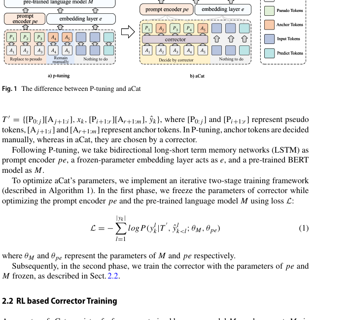
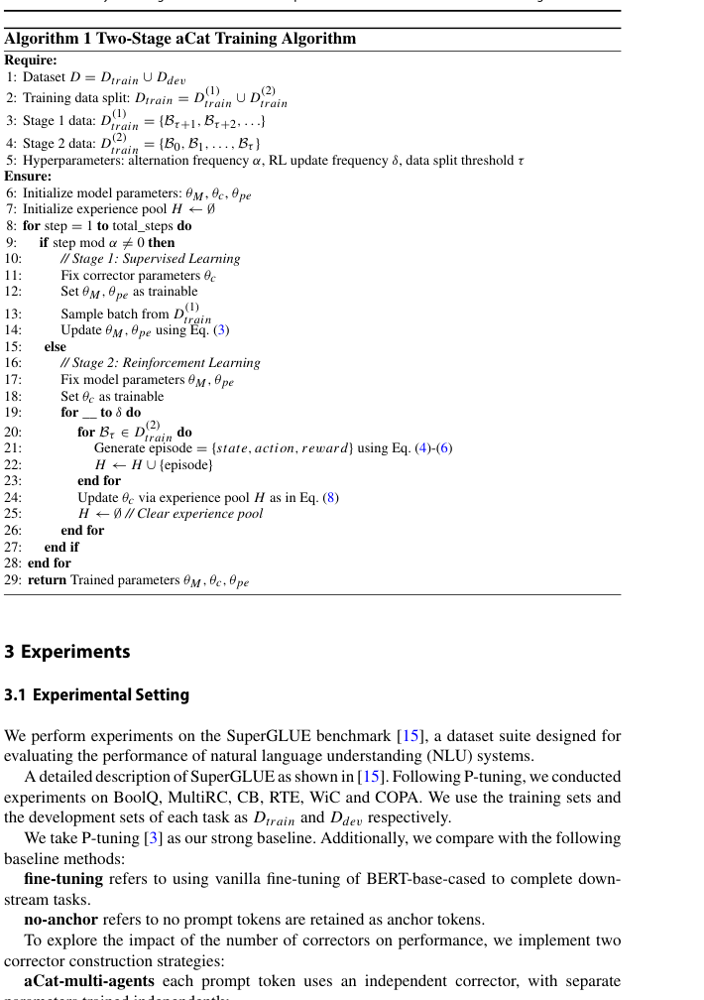
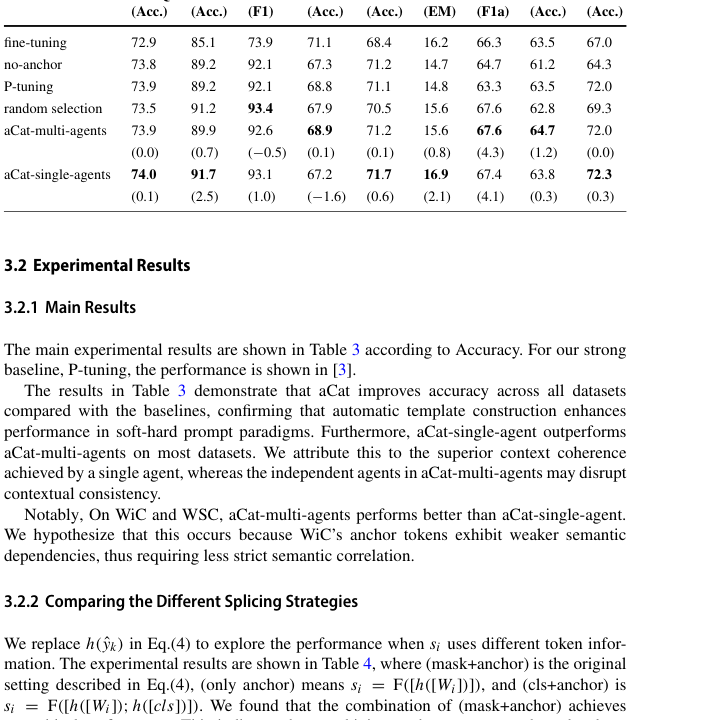
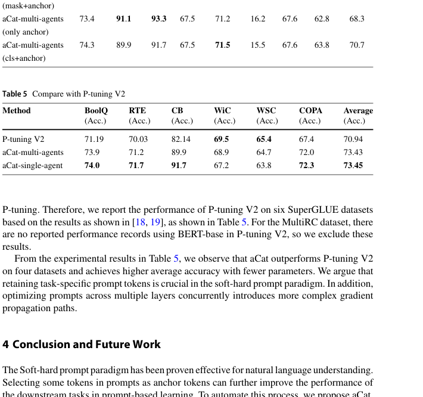

# Review Paper

### Identitas paper

#### Penulis & Tahun

Zhanhong Ye, Leilei Kong, dan Haoliang Qi (**2026**).

#### Judul Penelitian

*aCat: Automatically Choosing Anchor Tokens in Prompt for Natural Language Understanding*

#### Nama Jurnal

Artikel penelitian pada **Neural Processing Letters**, Volume 58, Article 31, tahun 2026. Artikel tersedia secara open access.

DOI: `10.1007/s11063-026-11837-2`.

### Tujuan penelitian

Penelitian ini mengatasi masalah pemilihan **anchor tokens** secara manual pada soft-hard prompt tuning. Pemilihan manual dapat bersifat subjektif dan menghasilkan prompt yang kurang optimal.

### Dataset dan evaluasi

Eksperimen dilakukan menggunakan benchmark **SuperGLUE** untuk Natural Language Understanding. Dataset yang digunakan meliputi:

- BoolQ;
- CB;
- WiC;
- RTE;
- MultiRC;
- WSC;
- COPA.

Model dibandingkan dengan fine-tuning, no-anchor, P-tuning, random selection, dan P-tuning V2. Evaluasi menggunakan accuracy, F1, atau exact match sesuai karakteristik tiap dataset.

### Metode atau arsitektur model

Penulis mengusulkan **aCat**, yaitu metode yang secara otomatis memilih prompt token yang dipertahankan sebagai anchor token.

Komponen utama aCat adalah:

1. **Corrector**, yang menentukan token mana yang dipertahankan sebagai anchor token.
2. **Prompt encoder**, yang mengubah token tertentu menjadi trainable pseudo-token embeddings.
3. **Embedding layer**, yang memetakan input, label, dan anchor token ke representasi vektor.
4. **Pre-trained language model**, yaitu BERT yang digunakan untuk menyelesaikan tugas downstream.

Corrector dilatih menggunakan reinforcement learning. Pada setiap posisi token, agent memilih salah satu dari dua tindakan: mempertahankan token sebagai anchor atau menggantinya dengan pseudo token.

aCat menggunakan training dua tahap secara iteratif:

1. **Supervised learning**: parameter corrector dibekukan, kemudian prompt encoder dan language model dilatih.
2. **Reinforcement learning**: prompt encoder dan language model dibekukan, kemudian corrector dilatih berdasarkan reward dari performa downstream task.

### Domain penelitian

Domain penelitian ini adalah **Natural Language Processing (NLP)**. Paper ini berfokus pada **Natural Language Understanding**, termasuk:

- question answering;
- sentiment atau textual entailment classification;
- paraphrase similarity;
- commonsense reasoning;
- word-sense disambiguation.

### Hasil utama

Hasil eksperimen menunjukkan bahwa aCat meningkatkan performa dibandingkan P-tuning pada sebagian besar dataset SuperGLUE. Varian **aCat-single-agent** umumnya menghasilkan performa yang lebih stabil karena seluruh prompt token diproses oleh satu corrector dengan konteks yang konsisten.

Dibandingkan P-tuning V2, aCat memperoleh rata-rata accuracy yang lebih tinggi pada eksperimen yang dilaporkan, dengan jumlah parameter trainable yang lebih sedikit.

### Analisis kontribusi model

Kontribusi utama aCat adalah:

- menghilangkan pemilihan anchor token secara manual;
- mempertahankan interpretabilitas hard prompt;
- memanfaatkan fleksibilitas soft prompt;
- menggunakan reinforcement learning untuk mengoptimalkan pemilihan token;
- mempertahankan jumlah parameter trainable yang relatif efisien.

### Kelebihan

- Merupakan metode NLP baru, bukan paper survey.
- Mengurangi subjektivitas dalam desain prompt.
- Menggabungkan hard prompt dan soft prompt.
- Diuji pada tujuh dataset SuperGLUE.
- Dapat meningkatkan performa dengan parameter trainable yang lebih sedikit dibandingkan pendekatan tertentu.

### Keterbatasan

- Proses reinforcement learning dapat membutuhkan komputasi yang besar.
- Pemilihan token dibatasi oleh kandidat token pada prompt awal.
- Agent dapat terjebak pada local optimum.
- Performa sensitif terhadap hyperparameter dan desain prompt awal.
- Eksperimen menggunakan BERT-base sehingga generalisasi ke LLM berukuran lebih besar masih perlu diuji.

### Kesimpulan review

aCat mengotomatisasi pemilihan anchor token dalam soft-hard prompt tuning melalui corrector berbasis reinforcement learning. Pendekatan ini mempertahankan token yang bermakna secara semantik sebagai hard prompt dan mengganti token lainnya dengan pseudo-token yang dapat dilatih. Hasil pada benchmark SuperGLUE menunjukkan peningkatan dibandingkan baseline prompt tuning, dengan keterbatasan pada biaya reinforcement learning dan potensi bias dari kandidat token serta local optimum.

### Sumber

1. Ye, Z., Kong, L., & Qi, H. (2026). *aCat: Automatically Choosing Anchor Tokens in Prompt for Natural Language Understanding*. **Neural Processing Letters, 58**, 31. https://doi.org/10.1007/s11063-026-11837-2
2. [Halaman artikel dan PDF gratis](https://link.springer.com/article/10.1007/s11063-026-11837-2)
