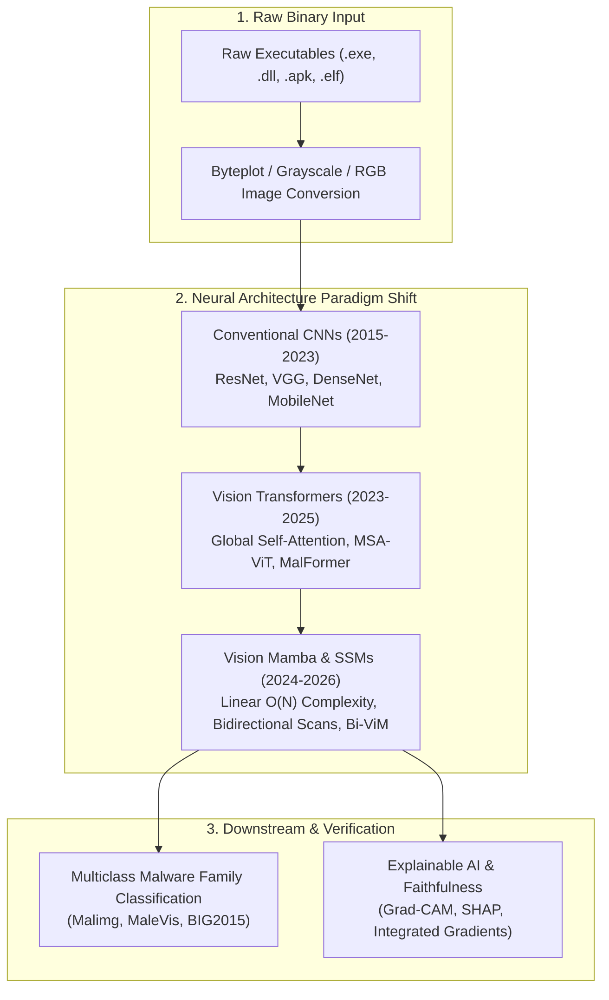

# 📖 Academic Research & Literature Review Hub

[](https://github.com/febriyansyah-id/PAPER-REVIEW)
[](index.html)
[](#)
[-0ea5e9.svg)](https://github.com/febriyansyah-id)
[](index.html)
[](https://creativecommons.org/licenses/by/4.0/)

> **Academic Literature Review Repository**: Systematic Literature Reviews (SLR) and empirical syntheses of **61 state-of-the-art research papers (2023–2026)** across Computer Vision for Cybersecurity, Vision Transformers (ViT), State Space Models (Vision Mamba), Binary Malware Image Classification, Natural Language Processing (LLM / RAG), and Explainable AI (XAI).  
> **Curator & Scholar**: **Febriyansyah** — Senior IT Cybersecurity & Infrastructure Leader | Graduate Student in *Magister Teknik Informatika* (MTI), Universitas Pamulang.

---

## 🖥️ Interactive Literature Review Console

A zero-dependency, client-side **Interactive Research Explorer & Paper Comparator** is built right into this repository:

👉 **Open [`index.html`](index.html) in your browser** to launch the interactive research console:
- 🔍 **Real-Time Instant Search**: Live fuzzy filtering across paper titles, authors, algorithms, and dataset keywords.
- 🏷️ **7 Domain Categorization Pills**: Instant toggle between Vision Transformers, Vision Mamba, CNN-Transformer Hybrids, NLP & LLMs, Non-Vision Detection, and XAI Surveys.
- 📅 **Year-by-Year Filtering**: Explore research evolution across 2023, 2024, 2025, and 2026 editions.
- 📊 **Dynamic Visual Analytics**: Interactive Doughnut and Bar charts powered by Chart.js displaying research topic distribution and timeline velocity.

---

## 🏛️ Research Taxonomy & Architectural Evolution

The papers in this repository document a major paradigm shift in binary malware analysis: transitioning from static heuristic disassemblers to **Image-Based Representation Learning** and next-generation neural backbones.



---

## 📊 Summary Statistics & Yearly Evolution

| Research Domain / Category | 2023 | 2024 | 2025 | 2026 | Total Papers |
| :--- | :---: | :---: | :---: | :---: | :---: |
| **Vision Transformer (ViT) untuk Klasifikasi Malware** | 2 | 4 | 2 | 1 | **9** |
| **Vision Mamba (ViM) & Visual SSM** | 0 | 5 | 2 | 0 | **7** |
| **Paper yang Membahas ViT dan ViM (Hybrid / Ablation)** | 0 | 2 | 0 | 0 | **2** |
| **Klasifikasi Malware Berbasis Citra (CNN, Multi-Task, Hybrid)**| 3 | 6 | 6 | 6 | **21** |
| **Natural Language Processing (NLP, RAG, LLM Alignment)** | 2 | 2 | 3 | 4 | **11** |
| **Deteksi Malware di Luar Klasifikasi Citra** | 1 | 1 | 1 | 0 | **3** |
| **Survei, Explainability (XAI), dan Kualitas Dataset** | 0 | 2 | 6 | 0 | **8** |
| **TOTAL KOLEKSI** | **8** | **22** | **21** | **10** | **61** |

---

## 📑 Curated Categorized Catalog

### 1. Vision Transformer (ViT) untuk Klasifikasi Malware

Paper yang secara eksplisit mengadopsi arsitektur Vision Transformer untuk mengklasifikasikan citra representasi biner malware.

| Tahun | Paper | Fokus Utama | Tautan Review |
| :---: | :--- | :--- | :---: |
| **2023** | Enhancing Malware Classification with Vision Transformers: A Comparative Study with Traditional CNN Models | ViT, CNN, Malimg malware images | [Buka Review 📄](2023%20-%20Enhancing%20Malware%20Classification%20with%20Vision%20Transformers%20A%20Comparative%20Study%20with%20Traditional%20CNN%20Models/README.md) |
| **2023** | ViT4Mal: Lightweight Vision Transformer for Malware Detection on Edge Devices | Lightweight ViT, malware images, IoT/FPGA | [Buka Review 📄](2023%20-%20ViT4Mal%20Lightweight%20Vision%20Transformer%20for%20Malware%20Detection%20on%20Edge%20Devices/README.md) |
| **2024** | Accelerating Malware Classification: A Vision Transformer Solution | LeViT-MC, MaleVis RGB, CNN–ViT dua tahap | [Buka Review 📄](2024%20-%20Accelerating%20Malware%20Classification%20A%20Vision%20Transformer%20Solution/README.md) |
| **2024** | Convolutional-free Malware Image Classification using Self-attention Mechanisms | RGB malware images, GAN oversampling, Vision Transformer | [Buka Review 📄](2024%20-%20Convolutional-free%20Malware%20Image%20Classification%20using%20Self-attention%20Mechanisms/README.md) |
| **2024** | Data-Efficient Image Transformers for Robust Malware Family Classification | DeiT, HGBO, citra RGB MaleVis dan MalNet-Image Tiny | [Buka Review 📄](2024%20-%20Data-Efficient%20Image%20Transformers%20for%20Robust%20Malware%20Family%20Classification/README.md) |
| **2024** | Vision Based Malware Classification Using Deep Neural Network with Hybrid Data Augmentation | Malimg, Vision Transformer, DCGAN and hybrid augmentation | [Buka Review 📄](2024%20-%20Vision%20Based%20Malware%20Classification%20Using%20Deep%20Neural%20Network%20with%20Hybrid%20Data%20Augmentation/README.md) |
| **2025** | Image-Based Malware Multiclass Classification Using Vision Transformer Architecture | ViT, Malimg, klasifikasi malware multikelas | [Buka Review 📄](2025%20-%20Image-Based%20Malware%20Multiclass%20Classification%20Using%20Vision%20Transformer%20Architecture/README.md) |
| **2025** | MalFormer: A Novel Vision Transformer Model for Robust Malware Analysis | Malware ViT, multiscale attention, robustness to obfuscation | [Buka Review 📄](2025%20-%20MalFormer%20A%20Novel%20Vision%20Transformer%20Model%20for%20Robust%20Malware%20Analysis/README.md) |
| **2026** | MSA-ViT: A Multi-Scale Vision Transformer for Robust Malware Image Classification | Multi-scale ViT, MaleVis, robustness | [Buka Review 📄](2026%20-%20MSA-ViT%20A%20Multi-Scale%20Vision%20Transformer%20for%20Robust%20Malware%20Image%20Classification/README.md) |

---

### 2. Vision Mamba (ViM) & Visual State-Space Models

Paper yang berfokus pada arsitektur Vision Mamba atau visual state-space models (SSM), menghadirkan efisiensi komputasi linier $\mathcal{O}(N)$ pada pemrosesan citra beresolusi tinggi.

| Tahun | Paper | Fokus Utama | Tautan Review |
| :---: | :--- | :--- | :---: |
| **2024** | A Survey on Visual Mamba | Survey, visual SSM taxonomy and applications | [Buka Review 📄](2024%20-%20A%20Survey%20on%20Visual%20Mamba/README.md) |
| **2024** | GroupMamba: Efficient Group-Based Visual State Space Model | Group SSM, multi-direction scan, ImageNet/COCO/ADE20K | [Buka Review 📄](2024%20-%20GroupMamba%20Efficient%20Group-Based%20Visual%20State%20Space%20Model/README.md) |
| **2024** | Malware Image Classification Based on Mamba | Mamba, state-space model, MalImg | [Buka Review 📄](2024%20-%20Malware%20Image%20Classification%20Based%20on%20Mamba/README.md) |
| **2024** | Vision Mamba: Efficient Visual Representation Learning with Bidirectional State Space Model | Bidirectional SSM, visual backbone, ImageNet/COCO/ADE20K | [Buka Review 📄](2024%20-%20Vision%20Mamba%20Efficient%20Visual%20Representation%20Learning%20with%20Bidirectional%20State%20Space%20Model/README.md) |
| **2024** | VSSD: Vision Mamba with Non-Causal State Space Duality | Non-causal SSD, visual SSM, ImageNet/COCO/ADE20K | [Buka Review 📄](2024%20-%20VSSD%20Vision%20Mamba%20With%20Non-Causal%20State%20Space%20Duality/README.md) |
| **2025** | DefMamba: Deformable Visual State Space Model | Deformable SSM scanning, ImageNet/COCO/ADE20K | [Buka Review 📄](2025%20-%20DefMamba%20Deformable%20Visual%20State%20Space%20Model/README.md) |
| **2025** | Mamba-Adaptor: State Space Model Adaptor for Visual Recognition | SSM adaptor, transfer learning, ImageNet/COCO | [Buka Review 📄](2025%20-%20Mamba-Adaptor%20State%20Space%20Model%20Adaptor%20for%20Visual%20Recognition/README.md) |

---

### 3. Paper yang Membahas ViT dan ViM (Hybrid & Ablation)

Paper Computer Vision yang secara kritis menguji sinergi, hibridisasi, atau komparasi langsung antara pendekatan Mamba visual dengan Transformer.

| Tahun | Paper | Fokus Utama | Tautan Review |
| :---: | :--- | :--- | :---: |
| **2024** | MambaOut: Do We Really Need Mamba for Vision? | SSM ablation, Gated CNN, ImageNet/COCO/ADE20K | [Buka Review 📄](2024%20-%20MambaOut%20Do%20We%20Really%20Need%20Mamba%20for%20Vision/README.md) |
| **2024** | MambaVision: A Hybrid Mamba-Transformer Vision Backbone | Hybrid CNN-Mamba-Transformer, ImageNet/COCO/ADE20K | [Buka Review 📄](2024%20-%20MambaVision%20A%20Hybrid%20Mamba-Transformer%20Vision%20Backbone/README.md) |

---

### 4. Klasifikasi Malware Berbasis Citra (CNN, Multi-Task & Hybrid)

Paper klasifikasi malware dari citra representasi biner yang mengandalkan inovasi pada CNN, Multi-Task Learning, augmentasi DCGAN, serta pengkodean semantik lossless.

| Tahun | Paper | Fokus Utama | Tautan Review |
| :---: | :--- | :--- | :---: |
| **2023** | CNN vs Transformer Variants - Malware Classification Using Binary Malware Images | CNN, Transformer, binary malware image | [Buka Review 📄](2023%20-%20CNN%20vs%20Transformer%20Variants%20-%20Malware%20Classification%20Using%20Binary%20Malware%20Images/README.md) |
| **2023** | Image-Based Malware Detection Using α-Cuts and Binary Visualisation | α-cut, binary visualization, ResNet50 | [Buka Review 📄](2023%20-%20Image-Based%20Malware%20Detection%20Using%20Alpha-Cuts%20and%20Binary%20Visualisation/README.md) |
| **2023** | Malware Detection Using Image Representation of Malware Data and Transfer Learning | Malimg, VGG16/ResNet-50, stacked ML | [Buka Review 📄](2023%20-%20Malware%20Detection%20Using%20Image%20Representation%20of%20Malware%20Data%20and%20Transfer%20Learning/README.md) |
| **2024** | A Comparative Performance Analysis of Malware Detection Algorithms Based on Various Texture Features and Classifiers | Malimg/MaleVis, texture descriptors, classical classifiers | [Buka Review 📄](2024%20-%20A%20Comparative%20Performance%20Analysis%20of%20Malware%20Detection%20Algorithms%20Based%20on%20Various%20Texture%20Features%20and%20Classifiers/README.md) |
| **2024** | Android Malware Detection Based on RGB Images and Multi-feature Fusion | Fusi DEX, manifest, API menjadi citra RGB | [Buka Review 📄](2024%20-%20Android%20Malware%20Detection%20Based%20on%20RGB%20Images%20and%20Multi-feature%20Fusion/README.md) |
| **2024** | Deep Learning Applied to Imbalanced Malware Datasets Classification | MobileNet FT, class imbalance, Malimg/MaleVis | [Buka Review 📄](2024%20-%20Deep%20Learning%20Applied%20to%20Imbalanced%20Malware%20Datasets%20Classification/README.md) |
| **2024** | Deep Multi-Task Learning for Malware Image Classification | Multi-task learning, citra malware lintas format | [Buka Review 📄](2024%20-%20Deep%20Multi-Task%20Learning%20for%20Malware%20Image%20Classification/README.md) |
| **2024** | Efficient and Generalized Image-Based CNN Algorithm for Multi-Class Malware Detection | CNN, multiclass malware detection | [Buka Review 📄](2024%20-%20Efficient%20and%20Generalized%20Image-Based%20CNN%20Algorithm%20for%20Multi-Class%20Malware%20Detection/README.md) |
| **2024** | Enhanced Image-Based Malware Classification Using Transformer-Based Convolutional Neural Networks | CNN-Transformer, malware images | [Buka Review 📄](2024%20-%20Enhanced%20Image-Based%20Malware%20Classification%20Using%20Transformer-Based%20Convolutional%20Neural%20Networks/README.md) |
| **2025** | An Efficient Malware Detection Method Using a Hybrid ResNet-Transformer Network and IGOA-Based Wrapper Feature Selection | ResNet, Transformer, feature selection | [Buka Review 📄](2025%20-%20An%20Efficient%20Malware%20Detection%20Method%20Using%20a%20Hybrid%20ResNet-Transformer%20Network%20and%20IGOA-Based%20Wrapper%20Feature%20Selection/README.md) |
| **2025** | An Explainable Hybrid CNN-Transformer Architecture for Malware Image Classification | Explainable AI, CNN-Transformer | [Buka Review 📄](2025%20-%20An%20Explainable%20Hybrid%20CNN-Transformer%20Architecture%20for%20Malware%20Image%20Classification/README.md) |
| **2025** | CNN-AutoMIC Combining Convolutional Neural Network and Autoencoder to Learn Non-Linear Features for KNN-Based Malware Image Classification | CNN, autoencoder, KNN | [Buka Review 📄](2025%20-%20CNN-AutoMIC%20Combining%20Convolutional%20Neural%20Network%20and%20Autoencoder%20to%20Learn%20Non-Linear%20Features%20for%20KNN-Based%20Malware%20Image%20Classification/README.md) |
| **2025** | Enhancing Malware Detection via RGB Assembly Visualization and Hybrid Deep Learning Models | RGB visualization, EfficientNet, DenseNet | [Buka Review 📄](2025%20-%20Enhancing%20Malware%20Detection%20via%20RGB%20Assembly%20Visualization%20and%20Hybrid%20Deep%20Learning%20Models/README.md) |
| **2025** | Multimodal Malware Classification Using Proposed Ensemble Deep Neural Network Framework | CNN-LSTM, late fusion, citra malware dan fitur numerik | [Buka Review 📄](2025%20-%20Multimodal%20Malware%20Classification%20Using%20Proposed%20Ensemble%20Deep%20Neural%20Network%20Framework/README.md) |
| **2025** | Semantic Lossless Encoded Image Representation for Malware Classification | Encoding bytecode lossless, CNN-SPP, row-patch Transformer | [Buka Review 📄](2025%20-%20Semantic%20Lossless%20Encoded%20Image%20Representation%20for%20Malware%20Classification/README.md) |
| **2025** | Through the Static: Demystifying Malware Visualization via Explainability | Replicability, GradCAM/HiResCAM, masking untuk ViT | [Buka Review 📄](2025%20-%20Through%20the%20Static%20Demystifying%20Malware%20Visualization%20via%20Explainability/README.md) |
| **2026** | AD-CapsFPN An Asymmetric Dilated Convolutional Capsule Network with Feature Pyramid for Malware Classification | Capsule network, feature pyramid | [Buka Review 📄](2026%20-%20AD-CapsFPN%20An%20Asymmetric%20Dilated%20Convolutional%20Capsule%20Network%20with%20Feature%20Pyramid%20for%20Malware%20Classification/README.md) |
| **2026** | Cybersecurity Oriented Malware Classification Using ParaECA-LSTMNet with a Hybrid Attention Guided CNN-LSTM Framework | Malimg grayscale, CNN-ECA-LSTM, klasifikasi keluarga | [Buka Review 📄](2026%20-%20Cybersecurity%20Oriented%20Malware%20Classification%20Using%20ParaECA-LSTMNet%20with%20a%20Hybrid%20Attention%20Guided%20CNN-LSTM%20Framework/README.md) |
| **2026** | Image-Based Malware Classification Using DCGAN-Augmented Data and a CNN-Transformer Hybrid Model | DCGAN, data augmentation, CNN-Transformer | [Buka Review 📄](2026%20-%20Image-Based%20Malware%20Classification%20Using%20DCGAN-Augmented%20Data%20and%20a%20CNN-Transformer%20Hybrid%20Model/README.md) |
| **2026** | MCPDS Image-Based Malware Classification Method Using Dual-Information Encoding and Pooling Depthwise Separable CNN | PE metadata, depthwise separable CNN | [Buka Review 📄](2026%20-%20MCPDS%20Image-Based%20Malware%20Classification%20Method%20Using%20Dual-Information%20Encoding%20and%20Pooling%20Depthwise%20Separable%20CNN/README.md) |
| **2026** | X-MET: Multimodal Entropy–Visual Deep Learning Technique for Strengthening Cyber Governance and Resilient Digital Infrastructure | Byteplot grayscale, entropy, fusi multimodal | [Buka Review 📄](2026%20-%20X-MET%20Multimodal%20Entropy-Visual%20Deep%20Learning%20Technique%20for%20Strengthening%20Cyber%20Governance%20and%20Resilient%20Digital%20Infrastructure/README.md) |

---

### 5. Natural Language Processing (NLP, RAG & LLMs)

Paper mengenai Large Language Models (LLM), fine-tuning efisien parameter (QLoRA), alignment (DPO), dan Retrieval-Augmented Generation (RAG).

| Tahun | Paper | Fokus Utama | Tautan Review |
| :---: | :--- | :--- | :---: |
| **2023** | QLoRA Efficient Finetuning of Quantized LLMs | Quantization, LoRA, PEFT | [Buka Review 📄](2023%20-%20QLoRA%20Efficient%20Finetuning%20of%20Quantized%20LLMs/README.md) |
| **2023** | Self-RAG Learning to Retrieve Generate and Critique Through Self-Reflection | Adaptive RAG, self-reflection | [Buka Review 📄](2023%20-%20Self-RAG%20Learning%20to%20Retrieve%20Generate%20and%20Critique%20Through%20Self-Reflection/README.md) |
| **2024** | Direct Preference Optimization DPO | LLM alignment, preference optimization | [Buka Review 📄](2024%20-%20Direct%20Preference%20Optimization%20DPO/README.md) |
| **2024** | REAR A Relevance-Aware Retrieval-Augmented Framework for Open-Domain Question Answering | RAG, relevance assessment, QA | [Buka Review 📄](2024%20-%20REAR%20A%20Relevance-Aware%20Retrieval-Augmented%20Framework%20for%20Open-Domain%20Question%20Answering/README.md) |
| **2025** | Advancing Few-Shot Named Entity Recognition with Large Language Model | Few-shot NER, metric learning, LLM | [Buka Review 📄](2025%20-%20Advancing%20Few-Shot%20Named%20Entity%20Recognition%20with%20Large%20Language%20Model/README.md) |
| **2025** | Construction and Implementation of Knowledge Enhancement Pre-Trained Language Model for Text Sentiment Analysis | Sentiment analysis, knowledge enhancement | [Buka Review 📄](2025%20-%20Construction%20and%20Implementation%20of%20Knowledge%20Enhancement%20Pre-Trained%20Language%20Model%20for%20Text%20Sentiment%20Analysis/README.md) |
| **2025** | GPT-NER Named Entity Recognition via Large Language Models | NER, text generation, self-verification | [Buka Review 📄](2025%20-%20GPT-NER%20Named%20Entity%20Recognition%20via%20Large%20Language%20Models/README.md) |
| **2026** | aCat Automatically Choosing Anchor Tokens in Prompt for Natural Language Understanding | Prompt tuning, reinforcement learning | [Buka Review 📄](2026%20-%20aCat%20Automatically%20Choosing%20Anchor%20Tokens%20in%20Prompt%20for%20Natural%20Language%20Understanding/README.md) |
| **2026** | Enriching the Low-Resource Neural Machine Translation with Large Language Model | Machine translation, knowledge distillation | [Buka Review 📄](2026%20-%20Enriching%20the%20Low-Resource%20Neural%20Machine%20Translation%20with%20Large%20Language%20Model/README.md) |
| **2026** | Improving Few-Shot Named Entity Recognition for Large Language Models Using Structured Dynamic Prompting with Retrieval Augmented Generation | Biomedical NER, dynamic prompting, RAG | [Buka Review 📄](2026%20-%20Improving%20Few-Shot%20Named%20Entity%20Recognition%20for%20Large%20Language%20Models%20Using%20Structured%20Dynamic%20Prompting%20with%20Retrieval%20Augmented%20Generation/README.md) |
| **2026** | Training-Free Layer Selection for Partial Fine-Tuning of Language Models | Partial fine-tuning, layer selection | [Buka Review 📄](2026%20-%20Training-Free%20Layer%20Selection%20for%20Partial%20Fine-Tuning%20of%20Language%20Models/README.md) |

---

### 6. Deteksi Malware di Luar Klasifikasi Citra

Paper analisis malware berbasis payload lalu lintas jaringan, entropi berkas terkompresi, dan model sekuensial.

| Tahun | Paper | Fokus Utama | Tautan Review |
| :---: | :--- | :--- | :---: |
| **2023** | Machine Learning Based Fileless Malware Traffic Classification Using Image Visualization | Cobalt Strike, visualisasi payload jaringan, CNN | [Buka Review 📄](2023%20-%20Machine%20Learning%20Based%20Fileless%20Malware%20Traffic%20Classification%20Using%20Image%20Visualization/README.md) |
| **2024** | Malware Analysis Using Transformer Based Models: An Empirical Study | Studi CNN, CNN–Transformer, dan ViT pada Android/IoT | [Buka Review 📄](2024%20-%20Malware%20Analysis%20Using%20Transformer%20Based%20Models%20An%20Empirical%20Study/README.md) |
| **2025** | OPTISTACK: A Hybrid Ensemble Learning and XAI-Based Approach for Malware Detection in Compressed Files | Entropy, stacking ensemble, XAI, compressed files | [Buka Review 📄](2025%20-%20OPTISTACK%20A%20Hybrid%20Ensemble%20Learning%20and%20XAI-Based%20Approach%20for%20Malware%20Detection%20in%20Compressed%20Files/README.md) |

---

### 7. Survei, Explainability (XAI), dan Kualitas Dataset

Tinjauan literatur sistematis (SLR), taksonomi teknik visualisasi, interpretabilitas model (SHAP, LIME, Grad-CAM), dan benchmark kualitas dataset citra malware (NR-IQA).

| Tahun | Paper | Fokus Utama | Tautan Review |
| :---: | :--- | :--- | :---: |
| **2024** | A Comprehensive Analysis of Explainable AI for Malware Hunting | XAI, explainable malware detection, SHAP/LIME/Grad-CAM | [Buka Review 📄](2024%20-%20A%20Comprehensive%20Analysis%20of%20Explainable%20AI%20for%20Malware%20Hunting/README.md) |
| **2024** | SoK: Visualization-Based Malware Detection Techniques | SoK, malware visualization taxonomy and research challenges | [Buka Review 📄](2024%20-%20SoK%20Visualization-Based%20Malware%20Detection%20Techniques/README.md) |
| **2025** | A Survey on ML Techniques for Multi-Platform Malware Detection: Securing PC, Mobile Devices, IoT, and Cloud Environments | Multi-platform malware, ML/DL, dataset and feature survey | [Buka Review 📄](2025%20-%20A%20Survey%20on%20ML%20Techniques%20for%20Multi-Platform%20Malware%20Detection/README.md) |
| **2025** | Application of Deep Learning in Malware Detection: A Review | Tinjauan sistematis, citra malware, sekuens, augmentasi | [Buka Review 📄](2025%20-%20Application%20of%20Deep%20Learning%20in%20Malware%20Detection%20A%20Review/README.md) |
| **2025** | Deep Learning Approaches for Malware Detection: A Comprehensive Review of Techniques, Challenges, and Future Directions | CNN/RNN/hybrid, tinjauan deteksi malware | [Buka Review 📄](2025%20-%20Deep%20Learning%20Approaches%20for%20Malware%20Detection%20A%20Comprehensive%20Review%20of%20Techniques%20Challenges%20and%20Future%20Directions/README.md) |
| **2025** | Explainable Artificial Intelligence (XAI) for Malware Analysis: A Survey of Techniques, Applications, and Open Challenges | XAI, SHAP/LIME/Grad-CAM, interpretabilitas malware | [Buka Review 📄](2025%20-%20Explainable%20Artificial%20Intelligence%20XAI%20for%20Malware%20Analysis%20A%20Survey%20of%20Techniques%20Applications%20and%20Open%20Challenges/README.md) |
| **2025** | MalScore: A Quality Assessment Framework for Visual Malware Datasets Using No-Reference Image Quality Metrics | NR-IQA, penilaian dataset malware visual, MaleVis | [Buka Review 📄](2025%20-%20MalScore%20A%20Quality%20Assessment%20Framework%20for%20Visual%20Malware%20Datasets%20Using%20No-Reference%20Image%20Quality%20Metrics/README.md) |
| **2025** | Systematic Review: Malware Detection and Classification in Cybersecurity | SLR, PRISMA, malware detection methods and datasets | [Buka Review 📄](2025%20-%20Systematic%20Review%20Malware%20Detection%20and%20Classification%20in%20Cybersecurity/README.md) |

---

## 🔬 Metodologi Telaah Paper (11-Point Review Protocol)

Setiap ulasan dalam repositori ini disusun secara teliti dan sistematis mengikuti protokol 11 poin:

```text
TAHUN - Judul Paper/
├── README.md           # Telaah komprehensif 11 poin
└── IMAGE/              # Diagram arsitektur asli, grafik konvergensi & tabel hasil
```

1. **Identitas Paper**: Judul resmi, penulis, tahun, nama jurnal/konferensi pengindeks, DOI terverifikasi, dan tanggal edisi rilis.
2. **Tujuan Penelitian**: Masalah ilmiah (*research gap*), hipotesis, dan objektif spesifik.
3. **Dataset & Evaluasi**: Dataset yang digunakan (Malimg, MaleVis, MalNet, dll.), rasio partisi *train-test*, konfigurasi hardware/GPU, dan metrik kuantitatif.
4. **Metode & Arsitektur Model**: Pipeline konversi citra, layer backbone neural network, modul fusi, dan fungsi loss.
5. **Gambar Visual Kunci**: Tangkapan diagram arsitektur asli dan grafik eksperimen di folder `IMAGE/`.
6. **Domain Penelitian**: Klasifikasi domain spesifik (Computer Vision untuk Cybersecurity, NLP, atau XAI).
7. **Hasil Utama**: Tabel performa komparasi (Akurasi, F1-score, Latensi inferensi, FLOPS/Parameter).
8. **Analisis Kontribusi Model**: Nilai kebaruan (*novelty*) terhadap pustaka ilmiah yang telah ada.
9. **Kelebihan**: Aspek teknis yang dieksekusi dengan sangat kuat dan terbukti empiris.
10. **Keterbatasan**: Ruang pengembangan, potensi bias dataset, atau tantangan komputasi.
11. **Kesimpulan & Sumber**: Rekomendasi telaah dan pranala sumber resmi.

---

<div align="center">
  <sub>Dikurasi dan Dikelola oleh <strong>Febriyansyah</strong> • Magister Teknik Informatika (MTI) • Open Science Repository</sub>
</div>
